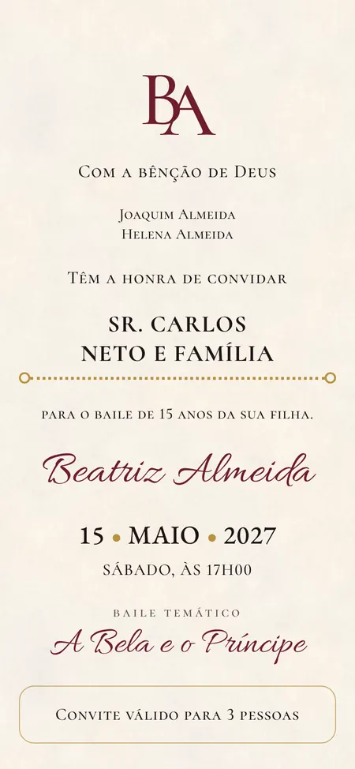
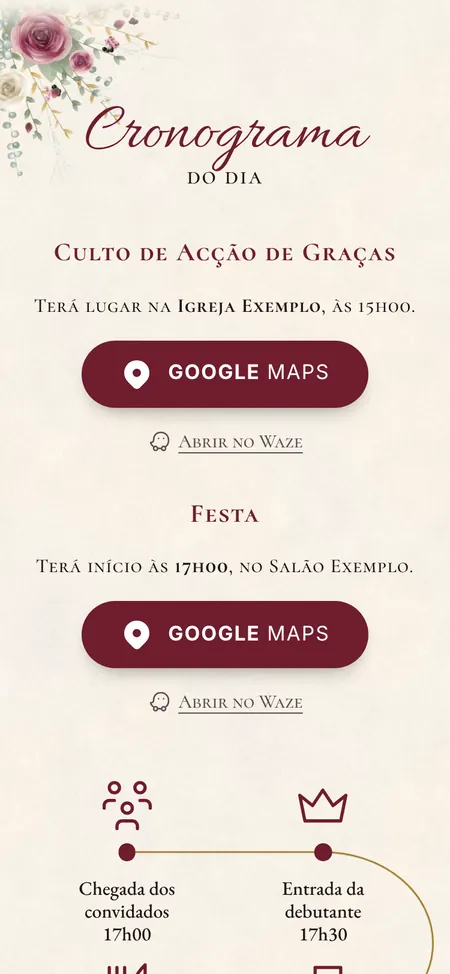

# celebramos.ao

**Convites digitais com a emoção de um convite de papel.** O convidado recebe um link pelo WhatsApp, abre um envelope com selo de cera e percorre o convite no telemóvel: quem convida, quando e onde, o programa, as regras da festa e a lista de presentes. Confirma a presença com um toque.

| Envelope | Convite | Cronograma |
|---|---|---|
|  |  |  |

*Tema «A Bela e o Príncipe» (vinho, preto e ouro), com dados fictícios.*

## Estado

- ✅ **Experiência do convite** especificada e implementada num **protótipo de referência**, validado com um cliente real (festa de 15 anos, Novembro de 2026).
- ✅ **Especificação da plataforma**: produto, modelo de dados, plataforma, requisitos, critérios de aceitação e roadmap.
- ⬜ **Plataforma** (back-office, convidados, confirmações, self-service): por construir. Começa pelo marco M1 do [roadmap](docs/08-roadmap.md).

## Para quem desenvolve

1. Ler o [**AGENTS.md**](AGENTS.md): regras do projecto, para pessoas e agentes de código.
2. Ler a [**documentação**](docs/README.md):

| | |
|---|---|
| [01 · Produto](docs/01-produto.md) | [05 · Plataforma](docs/05-plataforma.md) |
| [02 · Experiência do convite](docs/02-experiencia-do-convite.md) | [06 · Requisitos não funcionais](docs/06-requisitos-nao-funcionais.md) |
| [03 · Design e temas](docs/03-design-e-temas.md) | [07 · Critérios de aceitação](docs/07-criterios-de-aceitacao.md) |
| [04 · Modelo de dados](docs/04-modelo-de-dados.md) | [08 · Roadmap](docs/08-roadmap.md) |

3. Correr o protótipo:

```bash
cd prototipo
npm install
pip install -r requirements.txt
python3 -m playwright install chromium
npm run validar && npm run construir && npm run testar
python3 -m http.server -d exemplos/exemplo-bela-principe 8080   # http://localhost:8080
```

## Repositório

```
docs/        especificação, esquema JSON da configuração do convite, capturas de referência
prototipo/   convite de referência (HTML/CSS/JS), construção, testes de aceitação, arte procedural
```

## Licenças

Recursos de terceiros (Tabler Icons, MIT; fontes, SIL OFL 1.1) e notas sobre a arte original em [THIRD_PARTY_NOTICES.md](THIRD_PARTY_NOTICES.md). A licença do código deste repositório ainda não foi definida (ver decisão D7 no [roadmap](docs/08-roadmap.md#decisões-em-aberto)).
