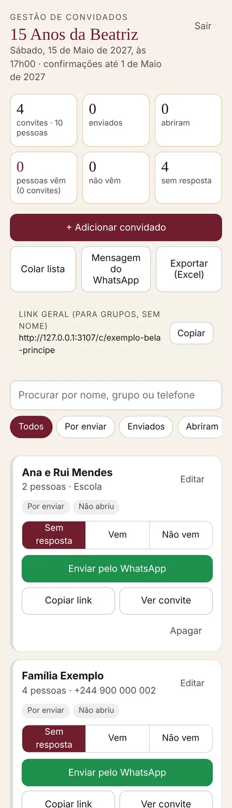

# apps/web — plataforma (primeira parte)

Aplicação Next.js com duas coisas:

1. **O convite servido pela plataforma**, com links pessoais `/c/{slug}/{token}`. O convidado é resolvido no servidor e o HTML só leva esse convidado. No link pessoal, o convidado responde no próprio convite (vou ou não vou, pessoas, mensagem) e, depois de gravar, pode avisar a família pelo WhatsApp com a mensagem já escrita ([decisão 0003](../../docs/decisoes/0003-confirmacao-dentro-do-convite.md)). O link geral é `/c/{slug}`, só com o WhatsApp.
2. **A zona de gestão de convidados** `/gestao/{slug}`, onde a família entra com um PIN e trata dos convidados:
   - cadastrar, um a um ou colando uma lista;
   - enviar cada link pelo WhatsApp;
   - ver quem abriu e as respostas que os convidados deram no convite;
   - marcar ou corrigir as respostas à mão;
   - exportar para Excel.

A experiência do convite vem do protótipo. `scripts/sincronizar-prototipo.mjs` copia `prototipo/template.html`, `icones.json` e os temas antes de `dev` e de `build`, e o protótipo continua a ser a fonte única. A aplicação fica alojada no **cPanel** ([decisão 0002](../../docs/decisoes/0002-alojamento-no-cpanel.md)).



## Correr localmente

```bash
cd apps/web
npm install
npm run semear          # eventos fictícios em .dados-locais/ (PIN 123456)
npm run dev             # http://localhost:3000/gestao/exemplo-bela-principe
```

Em desenvolvimento, sem `CELEBRAMOS_DADOS`, os dados ficam em `.dados-locais/` (ignorado pelo git).

## Testes

```bash
npm run pacote                    # next build + pacote do cPanel em dist/celebramos-web
python3 testes/e2e.py             # 72 verificações contra o pacote, a correr em 2 processos com os mesmos dados
python3 testes/e2e.py --capturas  # + capturas em testes/_capturas/
```

Precisam do Playwright para Python com o Chromium (como os testes do protótipo) e das fontes de `prototipo/node_modules` (`npm install` em `prototipo/`).

## Dados

Ficheiros JSON (e as fotos da galeria) na pasta `CELEBRAMOS_DADOS`, **fora da pasta da aplicação**, para sobreviverem às actualizações:

| Caminho | O quê |
|---|---|
| `eventos/{slug}/evento.json` | Evento: a configuração do convite (docs/04 §1), `gestao.pin` (hash scrypt do PIN da família) e `linkGeralActivo`. |
| `eventos/{slug}/img/{ficheiro}` | Fotos da galeria, referidas na configuração como `img/{ficheiro}`. O convite pede-as a `/c/{slug}/img/…` (link geral, só enquanto estiver activo) ou a `/c/{slug}/{token}/img/…` (link pessoal, só com token válido), com `Cache-Control: private`. |
| `eventos/{slug}/convidados.json` | Lista de convidados (com a última resposta dada no convite) e mensagem de envio. É gravada com concorrência optimista (ETag) e bloqueio entre processos, tanto pela família como pelas respostas dos convidados. |
| `eventos/{slug}/actividade/{token}/{tipo}-{ms}-…` | Marcadores vazios de «aberto», «confirmar» e «resposta». O painel agrega-os só pelos nomes. Os de «resposta» limitam as respostas a 10 por hora em cada link. |
| `eventos/{slug}/seguranca.json` | Tentativas de PIN falhadas (bloqueio de 15 minutos ao fim de 10). |
| `sistema/segredo-sessao.json` | Segredo de assinatura das sessões, se `SEGREDO_SESSAO` não estiver definido. |

**Dados reais nunca entram no repositório.** Para preparar um evento real, pôr a configuração numa pasta fora do repositório (ou em `prototipo/configs/privado/`, ignorada pelo git), com as fotos da galeria em `img/` ao lado dela (`"src": "img/foto-1.jpg"`):

```bash
npm install             # instala o sharp, que recodifica as fotos
node scripts/preparar-evento.mjs caminho/para/config.json [--pin 123456]
# → eventos-privados/<slug>/ (ignorado pelo git), com evento.json e img/: enviar para CELEBRAMOS_DADOS/eventos/<slug>/
```

As fotos são recodificadas em WebP, com 1600 px no máximo, o que apaga os metadados EXIF, incluindo a localização GPS ([docs/06](../../docs/06-requisitos-nao-funcionais.md#privacidade-e-protecção-de-dados)). Se faltar uma foto, o script pára e diz qual. Nos exemplos do protótipo, as fotos vêm do kit do tema.

## Publicar no cPanel

O servidor só **corre** a aplicação: o pacote chega pronto, sem `npm install` nem `next build` no cPanel. A conta tem 1 GB de memória, que não chega com segurança para construir.

### 1. Obter o pacote

- **Do GitHub (recomendado):** separador **Actions** → workflow «Plataforma» → execução mais recente do `main` → **Artifacts** → `celebramos-web` (ZIP).
- **Ou localmente:** `npm run pacote`. O pacote fica em `dist/celebramos-web/`.

O pacote tem `server.js`, `.next/` (pasta escondida: copiá-la também), `public/`, `node_modules/` (só o necessário) e `LEIA-ME.txt`.

### 2. Primeira vez

1. **Certificado TLS válido** para o domínio (SSL/TLS no cPanel, AutoSSL ou pelo fornecedor). Com um certificado auto-assinado, os convidados vêem avisos de segurança.
2. **Gestor de ficheiros:** criar
   - `/home/<utilizador>/celebramos-web`, a aplicação;
   - `/home/<utilizador>/celebramos-dados/eventos/<slug>/`, os dados.

   Enviar o ZIP do pacote para `celebramos-web` e extrair. Para a pasta de cada evento, enviar o que o `preparar-evento.mjs` gerou: o `evento.json` e, se houver galeria, a pasta `img/`.
3. **Setup Node.js App → Criar aplicação:**

   | Campo | Valor |
   |---|---|
   | Versão do Node.js | 24 (recomendado; mínimo 20) |
   | Modo de aplicação | Production |
   | Raiz da aplicação | `celebramos-web` |
   | URL da aplicação | `celebramos.ao` (raiz do domínio) |
   | Ficheiro de arranque | `server.js` |
   | Ficheiro de registo Passenger | `/home/<utilizador>/logs/celebramos.log` |

   Variáveis de ambiente:

   | Variável | Valor |
   |---|---|
   | `CELEBRAMOS_DADOS` | `/home/<utilizador>/celebramos-dados` (**obrigatória**) |
   | `URL_PUBLICO` | `https://celebramos.ao` (links enviados aos convidados) |
   | `SEGREDO_SESSAO` | (opcional) Sem ela, é gerado e guardado nos dados. |

   **Não** carregar em «Run NPM Install».
4. Iniciar a aplicação e abrir `https://celebramos.ao/gestao/<slug>`. Deve aparecer o ecrã do PIN.

### 3. Actualizar

1. Descarregar o pacote novo e extraí-lo por cima de `celebramos-web`. Apagar antes a pasta `.next` antiga, para não ficarem ficheiros de versões anteriores. Os dados em `celebramos-dados` não se tocam.
2. **Setup Node.js App → Restart.**
3. **Clear Cache** do NGINX (página inicial do cPanel).

### Problemas

- **Erro 500 em todas as páginas:** confirmar `CELEBRAMOS_DADOS`. Em produção é obrigatória, e o registo do Passenger mostra «Definir CELEBRAMOS_DADOS».
- **«Convite não encontrado»:** o `evento.json` não está em `CELEBRAMOS_DADOS/eventos/<slug>/` ou tem JSON inválido.
- **Fotos da galeria partidas:** falta a pasta `CELEBRAMOS_DADOS/eventos/<slug>/img/`, ou os nomes não coincidem com os `src` do `evento.json` (o script gera `foto-1.webp`, `foto-2.webp`…).
- **Alterações que não aparecem:** reiniciar a aplicação e limpar a cache do NGINX. O evento fica em memória até 60 s.
- **Cópias de segurança:** a pasta `celebramos-dados` entra nos backups da conta (JetBackup). Antes de mexer à mão, exportar a lista na zona de gestão.

## Limitações conhecidas

- A configuração do evento ainda não se edita na interface: muda-se o `evento.json` à mão. É o back-office do operador, E3 do roadmap.
- Os textos do convite continuam a ser preenchidos por JavaScript, porque o template vem do protótipo. O HTML final gerado no servidor fica para a E1-S2.
- Um só PIN por evento: todos os familiares usam o mesmo. Contas e papéis ficam para a E5-S5.
- Fotos de menores: a plataforma ainda não regista a autorização dos pais, e a galeria não vem desligada por omissão nos eventos de menores (docs/06, E8-S3 do roadmap). Até lá, quem prepara o evento confirma a autorização antes de pôr as fotos.
- Os dados ficam em ficheiros num servidor. Para vários servidores, passar para uma base de dados: a interface em `src/lib/armazenamento.ts` permite trocar.
