# 02 · Experiência do convite (o que o convidado vê)

Este é o documento central. Descreve, com valores exactos, a experiência que o convidado tem ao abrir um convite da celebramos.ao. A implementação de referência está em [`prototipo/`](../prototipo/) e os critérios verificáveis em [07](07-criterios-de-aceitacao.md).

> **Regra de ouro:** a experiência tem de ser fiel ao protótipo — tempos de animação, proporções, ordem e comportamento das secções. Quando houver dúvida, abra `prototipo/exemplos/exemplo-bela-principe/index.html` e compare.

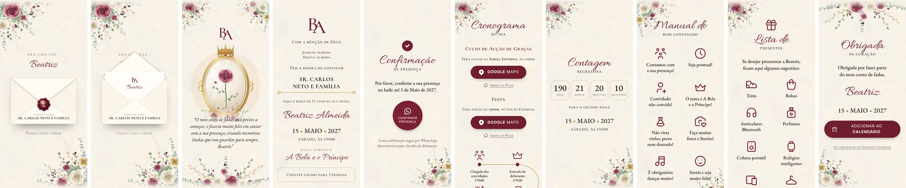

---

## 1. Fluxo

1. O convidado recebe um **link pessoal** pelo WhatsApp. A pré-visualização do WhatsApp mostra título e imagem do convite (Open Graph, ver [06](06-requisitos-nao-funcionais.md#seo-e-partilha)).
2. Abre o link no telemóvel e vê o **ecrã de abertura**: um envelope fechado, endereçado a ele.
3. Toca no envelope: o selo de cera salta, a aba abre, a carta sobe e o ecrã dissolve-se.
4. Fica na **primeira secção** do convite. Cada secção ocupa um ecrã inteiro e o deslizar «encaixa» no início de cada secção.
5. Pelo caminho pode: confirmar presença pelo WhatsApp, abrir o local no Google Maps ou no Waze, ver fotografias em ecrã inteiro, acompanhar a contagem regressiva e adicionar o evento ao calendário.
6. Se voltar a abrir o link **na mesma sessão** do navegador, o envelope não volta a aparecer.

---

## 2. Ecrã de abertura (envelope)

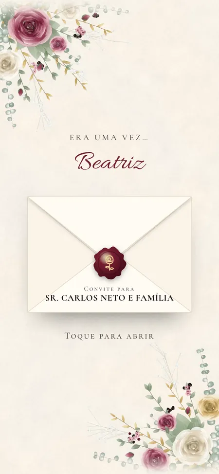 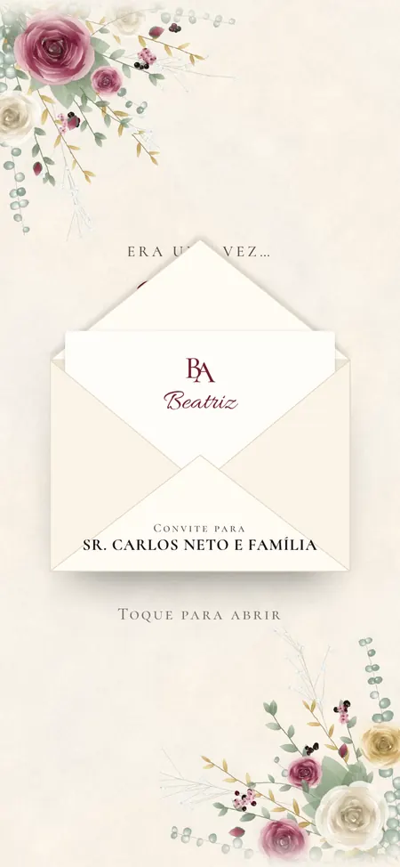

### 2.1 Composição

| Elemento | Especificação |
|---|---|
| Fundo | Cor do tema (`--bg`) + textura de papel (`--texture`), repetida na vertical, `background-size: 100% auto`. |
| Decoração | Canto floral em cima à esquerda e o mesmo canto rodado 180° (`scale(-1)`) em baixo à direita. Largura 62 % do ecrã, máx. 340 px, deslocados 3 % para fora (`translate(-3%,-3%)` / `translate(3%,3%) scale(-1)`). |
| Painel | Coluna centrada, `max-width: 30rem`, `gap: 1.75rem`, `padding: 2rem 1.5rem`, altura total. Unidade de escala `--pq = (min(largura do ecrã, 30rem) − 3rem) / 100`. |
| Linha de abertura (opcional) | Ex.: «Era uma vez…» — versaletes, maiúsculas, `letter-spacing: .2em`, cor `--muted`, tamanho `clamp(.9rem, 4.2·pq, 1.1rem)`, encostada ao nome (`margin-bottom: -1.4rem`). |
| Nome do homenageado | Letra manuscrita (Allura), cor `--script`, `clamp(2.8rem, 14·pq, 3.8rem)`. |
| Envelope | Botão. Largura `min(86·pq, 24rem)`, proporção **1,42 : 1**, `perspective: 1200px`. |
| «Toque para abrir» | Versaletes, `letter-spacing: .12em`, `clamp(1rem, 4.8·pq, 1.25rem)`, pulsa (opacidade .5 ↔ 1, 2,4 s, infinito). Sem pulsar com `prefers-reduced-motion`. |

### 2.2 Camadas do envelope (de trás para a frente)

1. **Fundo** — rectângulo com cantos de 0,35 rem, gradiente vertical da cor de sombra (`--env-shade`, 60 %) para o papel (`--env-paper`), sombra `0 24px 40px -22px rgba(0,0,0,.55)`.
2. **Carta** — `inset: 5% 5% auto`, altura 90 %, `padding-top: 7%`, cor `--env-letter`. Mostra o **monograma** (`clamp(1.8rem, 9·pq, 2.4rem)`) e o **nome** em manuscrito (`clamp(1.6rem, 8·pq, 2.2rem)`).
3. **Bolso** — SVG `viewBox 0 0 142 100`, `preserveAspectRatio="none"`, três dobras: laterais `M0 0 L66 55 L0 100 Z` e `M142 0 L76 55 L142 100 Z` (cor papel com 22 % de sombra) e inferior `M0 100 L71 45 L142 100 Z`. Traço 1 px `--env-shade`, `vector-effect: non-scaling-stroke`.
4. **Endereço** — no fundo do bolso (`bottom: 8%`, `inset-inline: 8%`): «Convite para» (versaletes, `letter-spacing: .16em`, `--muted`) e o **nome do convidado** em maiúsculas, negrito, `letter-spacing: .04em`.
5. **Aba** — SVG `viewBox 0 0 142 57`, triângulo `M0 0 L142 0 L71 57 Z`, altura 57 %, `transform-origin: 50% 0`, sombra `drop-shadow(0 3px 3px rgba(0,0,0,.16))`.
6. **Selo de cera** — 21 % da largura, centrado a 57 % da altura. Forma ondulada (círculo de raio ~45,5 com ondulação), gradiente radial (brilho → base → sombra, cores do tema), anel interior r = 33 com 45 % de opacidade. Desenho: texto (monograma ou «15», versaletes, algarismos *lining*) **ou** ícone (ex.: rosa em traço dourado).

### 2.3 Sequência de abertura (valores exactos)

Disparo: toque, clique, `Enter` ou `Espaço` no envelope. O botão fica desactivado durante a animação.

| # | Elemento | Animação | Duração | Curva |
|---|---|---|---|---|
| 1 | Selo | `transform: scale(1) → scale(1.12) → scale(0)` e `opacity: 1 → 1 → 0` | 500 ms | `ease-in` |
| 2 | Aba | `transform: rotateX(0deg) → rotateX(180deg)`; no fim passa para trás (`z-index: -1`) | 600 ms | `cubic-bezier(.45, 0, .2, 1)` |
| 3 | Carta | `transform: translateY(0%) → translateY(-40%)` | 650 ms | `ease-out` |
| 4 | Ecrã de abertura | `opacity: 1 → 0` | 550 ms (250 ms com movimento reduzido) | linear |

Os passos são **sequenciais** (cada um espera pelo fim do anterior). Total ≈ 2,3 s.

No fim:
- o ecrã de abertura é removido;
- o deslizamento da página é desbloqueado e o conteúdo deixa de estar `inert`;
- o foco vai para o título do convite (h1 só para leitores de ecrã), sem deslocar a página;
- se houver música, começa **no mesmo toque** (os navegadores só permitem áudio após um gesto do utilizador);
- guarda-se `sessionStorage["convite-aberto:<id>"] = "1"`.

Com `prefers-reduced-motion: reduce`, os passos 1–3 não acontecem e o passo 4 dura 250 ms.

Enquanto o envelope está fechado: `html { overflow: hidden }` e `main[inert]`.

> Na plataforma (renderização no servidor), um toque feito **antes** de o JavaScript carregar não se pode perder: registar o toque e executar a abertura assim que a página estiver interactiva.

---

## 3. Estrutura das secções

- Cada secção é um ecrã: `min-height: 100svh` (com `100vh` antes, para navegadores antigos). No computador, a altura do cartão (ver §6).
- Deslizar com encaixe: `scroll-snap-type: y` (proximidade) no contentor e `scroll-snap-align: start` em cada secção. Secções mais altas do que o ecrã (convite com ilustração, cronograma) deslizam normalmente.
- Contentor de conteúdo: `max-width: 30rem`, centrado, com `container-type: inline-size` (tamanhos em `cqi`).
- Interior de cada secção: coluna centrada, `justify-content: center`, `padding-block: 5rem`, `gap: 1.5rem` (variações por secção abaixo), texto centrado.
- **Títulos** (h2): palavra em manuscrito (`clamp(3rem, 15cqi, 4.5rem)`, `line-height: 1.15`, cor `--script`) + complemento em versaletes por baixo, sobreposto (`margin-top: -.6em`, `clamp(1.1rem, 5.4cqi, 1.5rem)`, `letter-spacing: .06em`, cor `--ink`). Opcionalmente um ícone de 56 px por cima, na cor `--accent`.

### 3.1 Ordem

A ordem é **configurável por convite** (`seccoes` na configuração). A ordem por omissão, validada com um cliente real (ver [01](01-produto.md#decisões-validadas)):

1. **Mensagem** (ilustração + citação) — é a primeira coisa que se vê depois do envelope
2. **Convite** («Com a bênção de Deus…»)
3. **Confirmação de presença**
4. *Galeria de fotos* (opcional; desligada por omissão em eventos de menores)
5. **Cronograma** (eventos, mapas e linha do tempo)
6. **Contagem regressiva**
7. **Manual do bom convidado**
8. **Lista de presentes** (opcional)
9. **Obrigado/Obrigada** (com calendário)

O convite de referência de mercado usa outra ordem (confirmação primeiro); o exemplo `exemplo-jardim-rose` reproduz essa variante.

---

## 4. Catálogo de secções

Para cada secção: propósito, conteúdo (campos da configuração em [04](04-modelo-de-dados.md)), composição e comportamento.

### 4.1 Mensagem

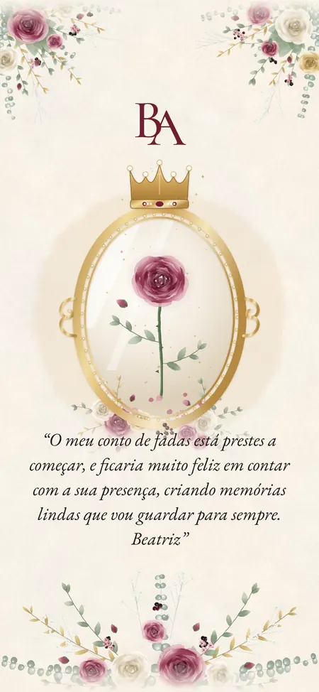

- **Propósito:** abrir o convite com emoção, na voz do homenageado.
- **Conteúdo:** monograma; ilustração do tema; citação (texto livre, pode ter várias linhas; a última linha costuma ser a assinatura).
- **Composição:** `gap: 0`, `padding-top: 3.5rem`, `padding-bottom: 30cqi`. Monograma `clamp(3.6rem, 17cqi, 4.6rem)`, por cima da ilustração. Ilustração a toda a largura com `margin-top: -16cqi` (o monograma fica sobre a zona vazia do topo da imagem). Citação em itálico (EB Garamond), `clamp(1.2rem, 5.6cqi, 1.45rem)`, `padding-inline: 2rem`, `white-space: pre-line`, com aspas curvas, `margin-top: -12cqi` (sobrepõe-se ao fundo esbatido da ilustração).
- **Regra da ilustração:** topo vazio suficiente para o monograma (≥ 16 % da largura) e fundo a dissolver-se no papel (máscara nos últimos ~17 %).

### 4.2 Convite

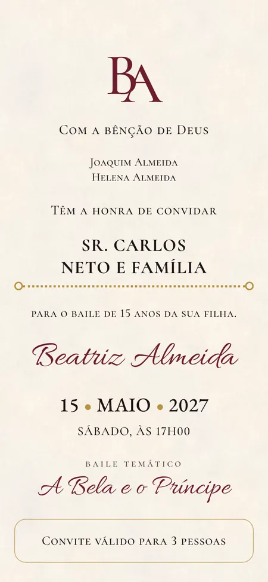

- **Propósito:** o convite formal.
- **Conteúdo e ordem:**
  1. Monograma grande (`clamp(4.5rem, 22cqi, 6rem)`). Monogramas de duas letras sobrepõem a segunda (`margin-left: -.3em; transform: translateY(.14em)`).
  2. Bênção (ex.: «Com a bênção de Deus») — versaletes `clamp(1.1rem, 5.2cqi, 1.4rem)`.
  3. **Anfitriões** — uma coluna centrada (um casal, um nome por linha) ou duas colunas (alinhadas à direita | à esquerda) quando há dois grupos (ex.: pais da noiva | pais do noivo). Versaletes `clamp(.9rem, 4.2cqi, 1.15rem)`.
  4. «Têm a honra de convidar» — **singular** («Tem») quando há um só anfitrião.
  5. **Nome do convidado** — maiúsculas, negrito, `clamp(1.3rem, 6.6cqi, 2rem)`, seguido de linha pontilhada com dois círculos nas pontas (cor `--gold`).
  6. Motivo (ex.: «para o baile de 15 anos da sua filha.»).
  7. Nome do homenageado em manuscrito (`clamp(2.6rem, 13cqi, 3.8rem)`).
  8. **Data**: «DD • MÊS • AAAA» (EB Garamond 500, maiúsculas, algarismos *lining*, numa só linha — `white-space: nowrap`, `clamp(1.45rem, 7.3cqi, 2.4rem)`; pontos de 0,5 rem na cor `--gold`) e por baixo «SÁBADO, ÀS 17H00».
  9. **Tema da festa** (opcional): «baile temático» em versaletes pequenas + o tema em manuscrito.
  10. «Convite válido para N pessoas» numa caixa de cantos arredondados — **só aparece com link pessoal** que tenha número de pessoas.
  11. **Ilustração do tema** no fundo da secção, a toda a largura (ex.: arco de balões com o «15»), com o fundo a dissolver-se no papel.
- `padding: 4rem 1.25rem 1.5rem`, `gap: 1.25rem`.

### 4.3 Confirmação de presença

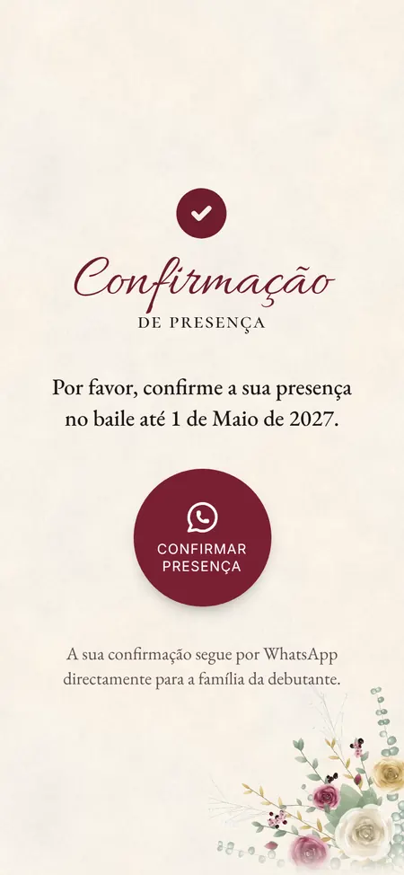

- Ícone «visto» preenchido, título «Confirmação / de presença», texto com o prazo («Por favor, confirme a sua presença no baile até 1 de Maio de 2027.»).
- **1 ou 2 botões redondos** (8 rem, fundo `--accent`, texto branco em maiúsculas, ícone WhatsApp 34 px), lado a lado com `gap: 1.5rem` (passam para baixo em ecrãs estreitos). Ex.: «Confirmar presença», ou «Confirmar presença (mãe)» e «(pai)», ou «(noivo)» e «(noiva)».
- Nota por baixo, a cor `--muted` (ex.: «A sua confirmação segue por WhatsApp directamente para a família da debutante.»).
- **Comportamento:** cada botão abre `https://wa.me/<número internacional sem +>?text=<mensagem>` num novo separador. A mensagem é gerada a partir de um modelo com o nome do convidado e o número de pessoas:
  `Olá! Confirmo a presença na festa de 15 anos da Beatriz (15 de Maio).\nConvidado: Sr. Carlos Neto e Família (3 pessoas)`.
  No link geral (sem convidado), `{convidado}` passa a «[o seu nome]».
- Sem número configurado (pré-visualização): o botão não abre nada e mostra um aviso no fundo do ecrã durante 3,8 s.
- **Na plataforma:** o toque é registado como intenção de confirmação (`sendBeacon`), sem atrasar a abertura do WhatsApp. O link continua a apontar directamente para `wa.me` (ver [05](05-plataforma.md#confirmações)).

### 4.4 Galeria de fotos (opcional)

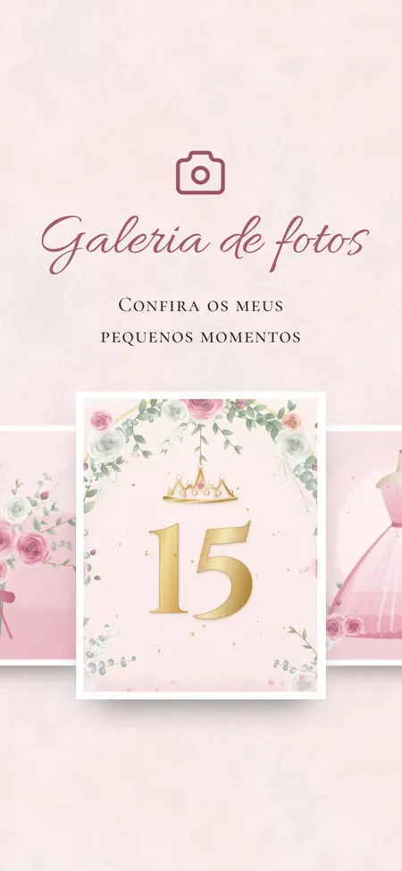

- Ícone câmara, título «Galeria de fotos», subtítulo (ex.: «Confira os meus pequenos momentos»).
- **Carrossel:** contentor com deslizamento horizontal e encaixe (`scroll-snap-type: x mandatory`), slides de **62 %** da largura, centrados, espaçadores de 19 % nas pontas. Começa centrado na **2.ª foto**.
- Cada foto numa moldura branca (`padding: .45rem`, sombra `0 18px 30px -18px rgba(0,0,0,.6)`), proporção **4:5**, `object-fit: cover`.
- **Efeito de profundidade:** para cada slide, `d = distância do centro / largura do slide`, `a = min(1, |d|)`: `transform: translateX(-sign(d)·18·a %) scale(1 − .22·a)`; `z-index` 10 no centro e 7 nos vizinhos. Actualizado a cada `scroll` (com `requestAnimationFrame`).
- **Ecrã inteiro:** tocar numa foto abre um `<dialog>` modal (fundo `rgba(12,10,14,.95)`), na foto tocada; fotos `object-fit: contain` com margem de 4,5 rem em cima e em baixo; botões redondos de 3 rem (fechar em cima à direita; anterior/seguinte em baixo, desactivados nas pontas); contador «Foto 2 de 3»; setas do teclado; `Esc` fecha. Enquanto aberto, a página por trás não desliza.
- **Privacidade:** em eventos de **menores**, a galeria fica desligada por omissão e só se liga com confirmação explícita do anfitrião (ver [06](06-requisitos-nao-funcionais.md#privacidade-e-protecção-de-dados)).

### 4.5 Cronograma

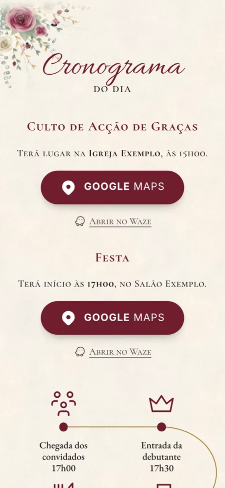

- Título «Cronograma / do dia».
- **Eventos** (ex.: «Culto de Acção de Graças», «Festa»): título em versaletes negrito, cor `--accent`; frase com o local em negrito («Terá lugar na **Igreja Exemplo**, às 15h00.»); botão em pílula **Google Maps** e ligação «Abrir no Waze». **Sem local definido, não há botões** (nunca enviar o convidado para um sítio errado).
  - Google Maps: `https://www.google.com/maps/search/?api=1&query=<lat>,<lng>` (ou o nome do local).
  - Waze: `https://waze.com/ul?ll=<lat>,<lng>&navigate=yes` (ou `?q=<nome>&navigate=yes`).
- **Linha do tempo em serpentina** (grelha de 3 colunas; **2 colunas** quando o contentor tem ≤ 339 px):
  - cada momento: ícone (3,2 rem, traço 1,25), ponto (0,9 rem, cor `--accent`), rótulo (até 2 linhas) e hora;
  - linhas da grelha com 9,5 rem; ponto a 43 % da altura da linha;
  - ordem em serpentina: linhas pares da esquerda para a direita, ímpares da direita para a esquerda;
  - a linha é um SVG gerado (`viewBox` 100 unidades por coluna e por linha, `preserveAspectRatio="none"`, `vector-effect: non-scaling-stroke`), com rectas entre os pontos e meias-voltas em arco (`A 56 50` com 2 colunas, `A 62 50` com 3) que alternam de lado; termina no último momento. Cor `--line`.

### 4.6 Contagem regressiva

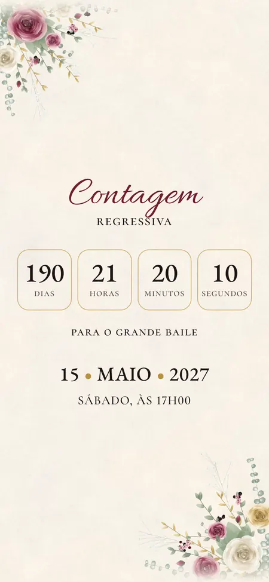

- Quatro caixas (dias, horas, minutos, segundos) em grelha de 4 colunas, `gap: .5rem`, cantos de 1 rem, borda `--border-contagem`. Número (EB Garamond 500, algarismos *lining* e tabulares, `clamp(2rem, 10cqi, 2.8rem)`) por cima da legenda (versaletes, `--muted`).
- Actualiza a cada segundo, sempre com dois dígitos. Depois da data: zeros e o texto passa a «chegou o grande dia!».
- Texto por baixo configurável (ex.: «para o grande baile»), seguido da data e da hora.

### 4.7 Manual do bom convidado

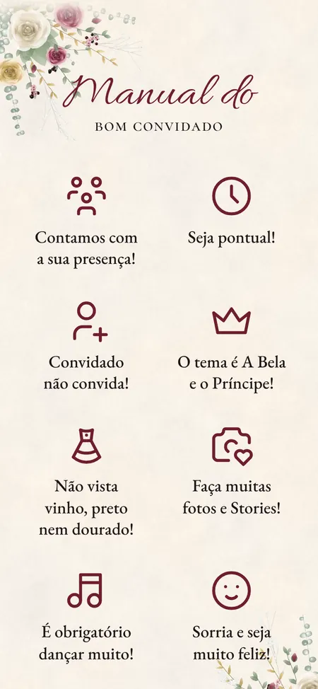

- Título «Manual do / bom convidado». Grelha de **2 colunas**, `gap` 2 rem × 1 rem; cada regra = ícone de 56 px + frase curta (`max-width: 10rem`).
- Regras típicas: «Contamos com a sua presença!», «Seja pontual!», «Convidado não convida!», tema da festa, **regras de traje** (ex.: «Não vista vinho, preto nem dourado!» ou «Branco é a cor da noiva!»), «Faça muitas fotos e Stories!», «É obrigatório dançar muito!», «Sorria e seja muito feliz!».

### 4.8 Lista de presentes (opcional)

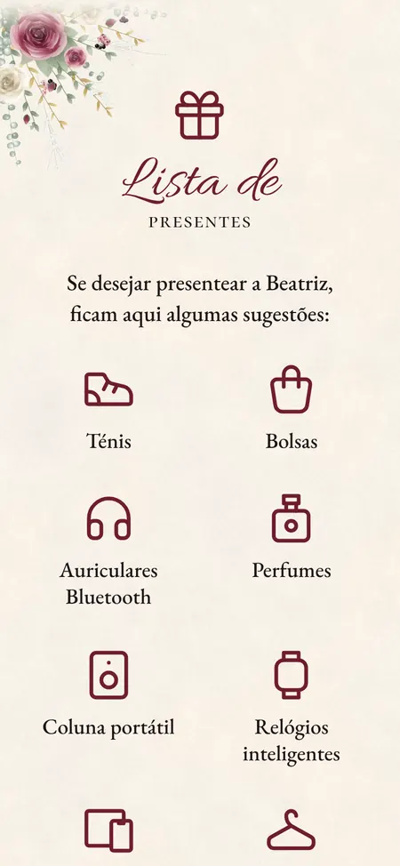

- Ícone presente, título «Lista de / presentes», texto de introdução.
- **Duas formas** (o anfitrião escolhe):
  - **Artigos** (preferida pelo cliente real): grelha igual à do manual — ícone + nome do artigo (ex.: Ténis, Bolsas, Auriculares Bluetooth, Perfumes, Coluna portátil, Relógios inteligentes, Tecnologia, Moda e beleza);
  - **Lojas:** cartões com nome, detalhe e ligações «Ver no mapa» / «Ver a lista».
- Nota final opcional.

### 4.9 Obrigado / Obrigada

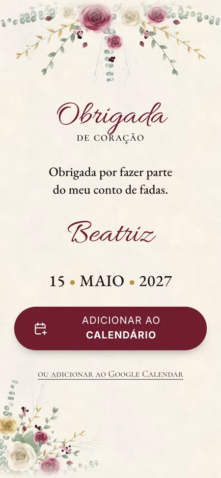

- Título (concordância com quem agradece: «Obrigada» quando é uma menina/mulher), texto, assinatura em manuscrito, data.
- **«Adicionar ao calendário»** (botão em pílula com ícone): descarrega `calendario.ics` (RFC 5545, com lembrete 1 dia antes). Por baixo: «ou adicionar ao Google Calendar».
- Onde o alojamento não permite descarregar ficheiros, o botão abre o Google Calendar e a ligação secundária o Outlook.

### 4.10 Música (opcional)

- Botão redondo flutuante (3 rem, em baixo à direita, cor `--accent`) com ícone de som ligado/desligado.
- Começa no toque do envelope; pausa quando a página fica oculta e retoma ao voltar; o convidado pode desligar.
- Só com música licenciada ou fornecida pelo anfitrião com direitos para o efeito.

---

## 5. Personalização por convidado

- **Link pessoal** por convidado (na plataforma: `/c/<evento>/<token>`; no protótipo, por limitação do alojamento: `#<código>`).
- O nome do convidado aparece no **envelope** e na secção **Convite**; o número de pessoas na caixa «Convite válido para N pessoas»; ambos entram na **mensagem de confirmação**.
- **Link geral** (sem convidado): envelope «Convite para Família e Amigos» (texto configurável), sem caixa de validade.
- Modo **demonstração** (para aprovação): o link geral mostra um convidado de exemplo. Desligar antes de enviar o convite.

---

## 6. Computador

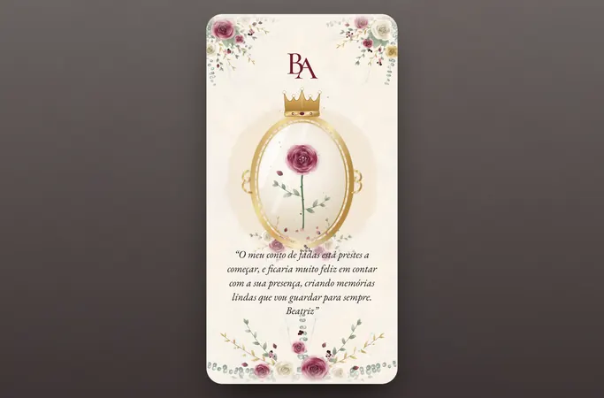

A partir de 700 px de largura **e** 560 px de altura o convite aparece como um telemóvel ao centro:

- cartão com `width: 27rem`, `height: min(100svh − 4rem, 58rem)`, cantos de 2,25 rem, sombra `0 0 0 1px #ffffff1f, 0 40px 80px -30px #000000d9`, a 2 rem do topo;
- fundo da página: textura do tema com véu escuro (`--backdrop-a` → `--backdrop-b`);
- o deslizar acontece **dentro** do cartão (`overflow-y: auto`, com encaixe e textura com `background-attachment: local`);
- o ecrã de abertura, o aviso e o botão de música ficam contidos no cartão (`contain: layout paint` no cartão).

---

## 7. Harmonia entre secções

As fronteiras entre secções foram a principal correcção pedida pelo cliente. Regras obrigatórias:

1. **Papel contínuo:** a textura vive no contentor de deslizamento, nunca por secção — não pode haver «costuras» de cor.
2. **Sem cortes a direito:** a camada de decoração de cada secção dissolve-se nos 34 px de cima e de baixo
   (`mask-image: linear-gradient(to bottom, transparent 0, #000 34px, #000 calc(100% - 34px), transparent 100%)`).
3. **Uma decoração por fronteira:** a mesma fronteira nunca tem decoração dos dois lados do mesmo lado do ecrã, nem grinalda/ilustração seguida de canto.
4. **Alternância diagonal:** quando uma secção termina com canto à direita, a seguinte pode começar com canto à esquerda (e vice-versa).
5. A **primeira secção** abre com dois cantos (esquerda e direita) e fecha com uma grinalda; a **última** abre com grinalda e fecha com um canto.
6. Secções com **ilustração no fundo** (Convite) ocupam a fronteira de baixo: a secção seguinte começa limpa.
7. As **ilustrações** dissolvem-se no papel no fundo (máscara) — nunca uma faixa de cor a toda a largura.

Distribuição validada (ordem por omissão):

| Secção | Decoração | Fronteira de baixo |
|---|---|---|
| Mensagem | cantos ↖ ↗ (40 %, máx. 220 px) + grinalda em baixo | grinalda |
| Convite | — (ilustração no fundo) | ilustração |
| Confirmação | canto ↘ (50 %, máx. 270 px) | canto ↘ |
| Cronograma | canto ↖ (42 %, máx. 230 px) | — |
| Contagem | canto ↖ (46 %) + canto ↘ (50 %) | canto ↘ |
| Manual | canto ↖ (46 %) + canto ↘ (50 %) | canto ↘ |
| Lista de presentes | canto ↖ (44 %, máx. 240 px) | — |
| Obrigada | grinalda em cima + canto ↙ (48 %, máx. 260 px) | — |

Códigos usados no protótipo: `canto:tl:54:300` = imagem «canto», em cima à esquerda, 54 % de largura, máx. 300 px. Posições: `tl` ↖, `tr` ↗ (`scaleX(-1)`), `bl` ↙ (`scaleY(-1)`), `br` ↘ (`scale(-1)`); `grinalda:top` / `grinalda:bottom` (`scale(-1)`), 100 %, máx. 480 px.

Na plataforma, a distribuição deve ser **calculada automaticamente** a partir da ordem das secções com estas regras (e poder ser ajustada à mão). Ver capturas `docs/img/bela-principe-2*-transicao-*.webp`.

---

## 8. Acessibilidade

- Envelope é um `<button>` com nome acessível («Abrir o convite de Beatriz»); foco visível (contorno de 2 px, afastado 10 px).
- `h1` só para leitores de ecrã («Convite para os 15 anos de Beatriz Almeida»); cada secção com `aria-labelledby` para o seu `h2` (visível ou só para leitores de ecrã).
- Decorações com `aria-hidden="true"` e `alt=""`.
- Contraste de texto ≥ 4,5:1 (texto pequeno) — validar sempre que se cria um tema.
- Aviso com `role="status"` e `aria-live="polite"`; contador da galeria com `aria-live`.
- `prefers-reduced-motion` respeitado em todas as animações.

## 9. Textos

- Português de Angola, ortografia **anterior ao Acordo Ortográfico de 1990** (acção, directamente, actual, baptizado) e meses com maiúscula («21 de Novembro de 2026»).
- Concordância de género e número com o homenageado e os anfitriões («Obrigada», «da sua filha», «Tem/Têm a honra»).
- Não assumir religião: «Missa», «Culto de Acção de Graças» ou nenhum — sempre texto livre.
- Nenhum texto fixo pode depender de um tipo de evento: tudo o que aparece no convite vem da configuração (com valores por omissão por tipo de evento).
