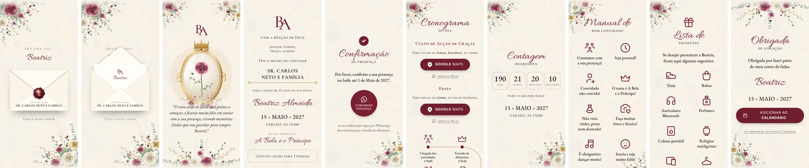
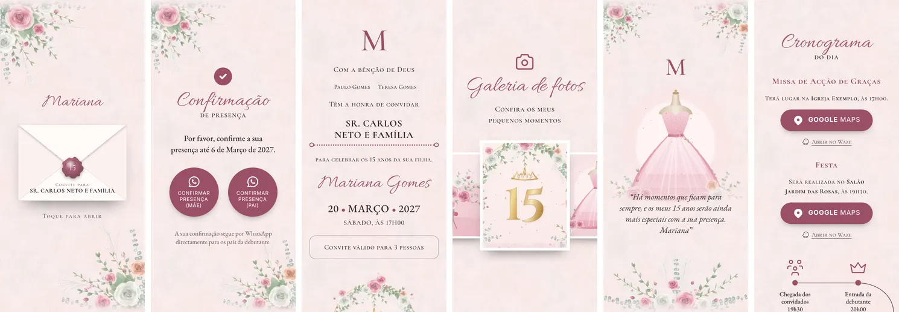

# 03 · Design e temas

O convite parece papelaria fina: papel com textura, letra manuscrita, versaletes, ornamentos florais e ouro. Um **tema** junta as cores, a arte e o selo. A estrutura e o comportamento são os mesmos em todos os temas.

| «A Bela e o Príncipe» (vinho, preto e ouro) | «Jardim Rosé» |
|---|---|
|  |  |

## Princípios

1. **Papel contínuo.** A textura do papel cobre o convite inteiro, sem costuras entre secções.
2. **Ornamento com contenção.** No máximo uma decoração por fronteira entre secções, e a decoração nunca tapa texto.
3. **Hierarquia por tipografia.** Manuscrito para nomes e títulos, versaletes para a informação e serifa para o texto corrido.
4. **Feito para o polegar.** Botões de confirmação grandes (8 rem) e ligações de mapa a toda a largura útil.
5. **Leve.** Cada imagem tem uma função e um orçamento de peso (ver «Kit de um tema»).

## Tipografia

Três famílias, todas com licença SIL Open Font License (ver [THIRD_PARTY_NOTICES](../THIRD_PARTY_NOTICES.md)):

| Papel | Família | Pesos | Utilização |
|---|---|---|---|
| Manuscrito | **Allura** | 400 | Nome do homenageado, palavra principal dos títulos, assinaturas, tema da festa |
| Versaletes | **Cormorant SC** | 500, 700 | Monograma, informação (anfitriões, horas, rótulos), links secundários |
| Texto | **EB Garamond** | 400, 500, itálico 400/500 | Texto corrido, citação da mensagem, data |
| Botões | Sans do sistema (`ui-sans-serif, system-ui, …`) | normal | Texto dos botões (redondos e em pílula), em maiúsculas com `letter-spacing: .06em` |

- Algarismos **lining** (`font-variant-numeric: lining-nums`) em datas, horas e contagem. A contagem usa também algarismos tabulares, para não «saltar».
- Na plataforma, as fontes **devem ser alojadas no próprio domínio** (por exemplo, a partir dos pacotes `@fontsource`, subconjunto latino em `woff2`) com `font-display: swap` e pré-carregamento das fontes do ecrã de abertura (Allura e Cormorant SC 500). O protótipo usa o Google Fonts só por comodidade.
- Tamanhos fluidos com `clamp()` em unidades de contentor (`cqi`), com alternativa em `vw` para navegadores antigos. Os valores de cada elemento estão no [02](02-experiencia-do-convite.md).

## Cor: tokens do tema

Cada tema define estas variáveis CSS (todas obrigatórias):

| Token | Para quê | Bela e o Príncipe | Jardim Rosé |
|---|---|---|---|
| `--bg` | Cor do papel (fundo) | `#f7f2ea` | `#f6ebe9` |
| `--ink` | Texto principal | `#1f1416` | `#3a272c` |
| `--muted` | Texto secundário, legendas | `#5f4c4f` | `#6d555b` |
| `--script` | Texto manuscrito | `#6f1d2e` | `#a65b72` |
| `--accent` | Botões, ícones, títulos de eventos, pontos da linha do tempo | `#6f1d2e` | `#9b5068` |
| `--accent-contrast` | Texto sobre `--accent` | `#fff` | `#fff` |
| `--line` | Linha do tempo (serpentina) | `#a8843b` | `#6e4654` |
| `--gold` | Pontos da data, linha pontilhada do nome | `#b8913f` | `#9b5068` |
| `--seal` / `--seal-ink` | Selo (cor de base e cor do desenho) | `#6d1a2b` / `#ecd393` | `#b0687e` / `#fbe8ee` |
| `--env-paper` / `--env-shade` / `--env-letter` | Envelope: papel, sombra e carta | `#fffbf4` / `#e6d9c3` / `#fffdf8` | `#fffaf8` / `#ecd6d7` / `#fffdfb` |
| `--backdrop`, `--backdrop-a`, `--backdrop-b` | Fundo e véu do computador | `#140b0d`, 62 %, 82 % | `#1d1217`, … |
| `--border-valido`, `--border-contagem` | Bordas da caixa «válido para» e da contagem | ouro a 70 % / 65 % | `--ink` a 40 % / `--accent` a 50 % |

O **selo de cera** tem um gradiente radial próprio (`tema.selo`): `brilho` → `base` → `sombra`, e um anel interior (`anel`) a 45 % de opacidade.

### Regras de contraste (obrigatórias para publicar um tema)

| Par | Mínimo | Bela e o Príncipe | Jardim Rosé |
|---|---|---|---|
| `--ink` sobre `--bg` | 4,5:1 | 16,1 | 11,9 |
| `--muted` sobre `--bg` | 4,5:1 | 7,2 | 5,8 |
| `--accent` sobre `--bg` (títulos pequenos, ícones) | 4,5:1 | 10,0 | 4,8 |
| `--accent-contrast` sobre `--accent` (texto dos botões) | 4,5:1 | 11,1 | 5,6 |
| `--script` sobre `--bg` (só texto grande, ≥ 2,6 rem) | 3:1 | 10,0 | 4,1 |
| `--seal-ink` sobre `--seal` (desenho grande) | 3:1 | 7,8 | 3,5 |
| `--gold`, `--line` | decorativo: **nunca** usar em texto | 2,6 / 3,1 | 4,8 / 6,7 |

A plataforma **tem de** calcular estes contrastes quando um tema é criado ou alterado e recusar a publicação de um tema que não os cumpra.

## Componentes

| Componente | Especificação resumida |
|---|---|
| **Título de secção** | Palavra em Allura (`clamp(3rem, 15cqi, 4.5rem)`, `--script`) e complemento em versaletes sobreposto (`margin-top: -.6em`). Ícone opcional de 56 px em `--accent`. |
| **Monograma** | Cormorant SC 500 em `--accent`. Com duas letras, a segunda fica `-.3em` à esquerda e `.14em` abaixo. |
| **Botão redondo** (confirmação) | Círculo de 8 rem, fundo `--accent`, texto `--accent-contrast` (sans do sistema, maiúsculas, `.8rem`), ícone WhatsApp 34 px, sombra `0 8px 18px -10px rgb(0 0 0 / .55)`. |
| **Botão em pílula** (Google Maps, calendário) | Mesmo estilo do botão redondo, em pílula: `min-height: 3.5rem`, `padding: .75rem 2rem`, `1.05rem`, ícone 28 px. |
| **Link secundário** | Cormorant SC 500, `1rem`, cor `--muted`, sublinhado afastado 4 px, ícone 20 px (Waze, «ou adicionar ao Google Calendar»). |
| **Caixa «válido para»** | Cantos 1 rem, borda `--border-valido`, versaletes. Só aparece com link pessoal. |
| **Linha do nome do convidado** | Linha pontilhada em `--gold` com um círculo em cada ponta. |
| **Caixa da contagem** | 4 colunas, cantos 1 rem, borda `--border-contagem`. |
| **Item do manual / presente** | Ícone de 56 px (traço 1,5) e frase curta (`max-width: 10rem`). |
| **Cartão de loja** | Ícone de loja, nome, detalhe e ligações «Ver no mapa» e «Ver a lista». |
| **Aviso (toast)** | Caixa escura centrada no fundo do ecrã (cantos de 1 rem, `max-width: 22rem`), visível 3,8 s, `role="status"`. |
| **Botão de música** | 3 rem, flutuante em baixo à direita, `--accent`. |
| **Ecrã inteiro da galeria** | `<dialog>` escuro, botões de 3 rem e contador. |

## Ícones

- Base: **[Tabler Icons](https://tabler.io/icons)** (licença MIT), estilo de traço com pontas e junções redondas.
- Os ícones usados são extraídos para [`prototipo/icones.json`](../prototipo/icones.json) (só os caminhos SVG, para não carregar a biblioteca inteira).
- Os ícones próprios seguem a mesma grelha de 24 × 24 e o mesmo traço. Existe um: `vestido` (definido no `template.html`).
- Tamanhos: 24 px (por omissão), 56 px (manual, presentes e títulos), 34 px (WhatsApp), 3,2 rem (linha do tempo, traço 1,25).
- Ícones disponíveis no protótipo: `brand-waze`, `brand-whatsapp`, `building-store`, `cake`, `calendar-plus`, `camera`, `camera-heart`, `candle`, `chevron-left`, `chevron-right`, `circle-check-filled`, `clock`, `confetti`, `crown`, `device-speaker`, `device-watch`, `devices`, `gift`, `glass-full`, `hanger`, `headphones`, `heart`, `map-pin-filled`, `mood-smile`, `music`, `perfume`, `shoe`, `shopping-bag`, `sparkles`, `tools-kitchen-2`, `user-plus`, `users-group`, `vestido`, `volume`, `volume-off`, `x`.
- Na plataforma, o editor tem de oferecer um selector de ícones a partir de um catálogo curado (por categoria: festa, comida, música, traje, presentes…).

## Kit de um tema

Cada tema é uma pasta com estas imagens (WebP; transparentes, excepto o papel):

| Ficheiro | Dimensões | Função | Orçamento |
|---|---|---|---|
| `papel.webp` | 900 × 1400, opaco | Textura de papel, repetida na vertical (`background-size: 100% auto`). As margens de cima e de baixo têm de encaixar sem costura. | ≤ 40 KB |
| `florais-canto.webp` | 640 × 640 | Canto floral principal, desenhado para o canto superior esquerdo (rodado nos outros cantos). | ≤ 130 KB |
| `florais-canto-alt.webp` | 640 × 640 | Variante do canto, para alternar e evitar repetição. | ≤ 130 KB |
| `grinalda.webp` | 1200 × 520 | Grinalda horizontal para o fundo de uma secção (ou topo, rodada). | ≤ 150 KB |
| `ilustracao-15.webp` | 1200 × 1000 | Ilustração do fundo da secção Convite (ex.: arco com o «15»). Os últimos ~15–20 % dissolvem-se no papel (máscara). | ≤ 130 KB |
| ilustração da mensagem (`espelho.webp`, `vestido.webp`…) | 1200 × 1270–1400 | Ilustração da secção Mensagem. **Topo vazio ≥ 16 %** da largura (para o monograma) e fundo dissolvido a partir de ~76–83 %. | ≤ 150 KB |

Regras:

- Arte **original** e sem texto embutido (excepto números decorativos como o «15»). Os nomes vêm sempre da configuração.
- Os cantos são desenhados para o **canto superior esquerdo**, com a composição a sair pelas margens de cima e da esquerda. O mesmo ficheiro é espelhado para os outros cantos (`scaleX(-1)`, `scaleY(-1)`, `scale(-1)`), por isso não pode ter elementos que fiquem mal ao contrário (texto, sombras com direcção marcada).
- Paleta do tema coerente com os tokens: os tons das flores e do ouro repetem `--accent`, `--seal` e `--gold`.
- A plataforma deve gerar variantes **AVIF + WebP** e tamanhos responsivos (`srcset`) a partir dos originais.

## Pipeline de arte (procedural, no protótipo)

A arte dos dois temas foi **gerada por código**: SVG desenhado em Python, convertido em PNG com o Chromium e depois em WebP. Assim, a arte é original, reprodutível e fácil de variar (cores, composição).

```
prototipo/arte/
  arte.py        primitivas e composições (rosas, botões, folhas, eucalipto, ramos, balões, espelho, vestido, grinalda, cantos)
  papel.py       textura de papel: ruído periódico por FFT (manchas, fibras e grão), sem costuras na vertical
  render.py      SVG → PNG transparente com Chromium (Playwright) e as fontes locais
  gerar_arte.py  um procedimento por tema: paleta, composição, máscaras de dissolução e exportação WebP
```

- **Sementes fixas:** a mesma versão do código gera sempre as mesmas imagens.
- `mascarar(svg, W, H, inicio, dy, H0)` dissolve o fundo de uma ilustração no papel a partir de `inicio` (0–1) e acrescenta folga no topo (`dy`).
- Comando: `npm run arte` (todos os temas) ou `python3 arte/gerar_arte.py bela-principe`.

### Criar um tema novo

1. Partir da **referência do cliente** (fotografia da decoração, cores, conceito) e escrever o tema em uma linha. Exemplo: «conto de fadas; vinho, preto e ouro; rosas, coroa, espelho».
2. Definir os **tokens** e verificar os contrastes (tabela acima).
3. Criar a função do tema em `gerar_arte.py` (paleta e composições) e gerar o kit.
4. Criar uma configuração de exemplo **fictícia** em `prototipo/configs/` e construir (`python3 construir.py configs/<exemplo>.json`).
5. Ajustar a **decoração por secção** (regras do [02 §7](02-experiencia-do-convite.md#7-harmonia-entre-secções)) e rever as transições nas capturas (`--capturas`).
6. Correr os testes (`python3 testes/verificar.py exemplos/<id>`). Os critérios estão no [07](07-criterios-de-aceitacao.md).
7. Acrescentar ao `docs/img/` as capturas de referência do tema.

Na plataforma, um tema é um registo (tokens, selo, imagens) criado no back-office. A arte pode vir deste pipeline, de um ilustrador ou de outra fonte com direitos claros.

## Propriedade intelectual

Regras obrigatórias para todos os temas, ilustrações, ícones, fontes e músicas:

1. **Nada de personagens, logótipos ou cenas protegidas**, nem «parecidos» (por exemplo, princesas de estúdios de animação, super-heróis, mascotes de marcas). Um tema pode evocar um **conceito genérico** («A Bela e o Príncipe», «conto de fadas», «jardim encantado») com arte própria.
2. **Nada copiado do convite de referência** nem de outros sites: imagens, código, textos ou ícones. A experiência (envelope, secções) é inspiração e foi reimplementada de raiz.
3. **Fontes e ícones** só com licenças livres que permitam uso comercial e incorporação na web (OFL, MIT, Apache). Registar cada novo recurso em [THIRD_PARTY_NOTICES.md](../THIRD_PARTY_NOTICES.md).
4. **Fotografias do cliente** só com autorização de quem as fornece. Em eventos de menores, só com autorização expressa dos pais (ver [06](06-requisitos-nao-funcionais.md#privacidade-e-protecção-de-dados)).
5. **Música** só com licença para uso na web ou fornecida pelo cliente com direitos para esse uso.
6. Se o cliente pedir um tema associado a uma marca, propor a versão genérica e explicar porquê.
