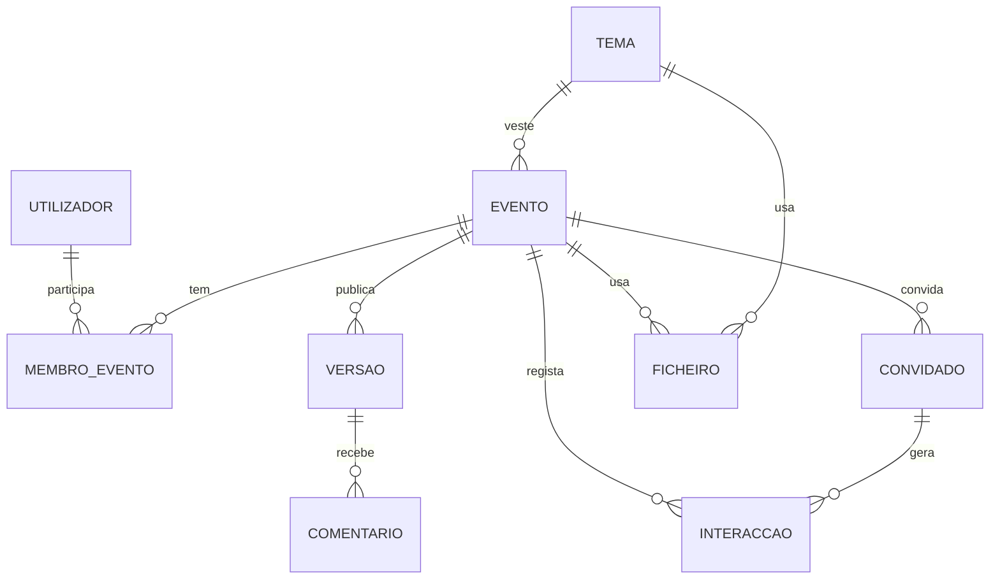

# 04 · Modelo de dados

Há duas camadas:

1. **Configuração do convite.** É o JSON que o renderizador consome (o contrato do `prototipo/template.html`). Está formalizado em [`esquemas/convite.schema.json`](esquemas/convite.schema.json) e é validado por `prototipo/testes/validar_config.py`.
2. **Modelo de domínio da plataforma.** São as entidades guardadas na base de dados: eventos, temas, versões, convidados, interacções. A configuração do convite é **gerada** a partir delas quando se publica.

```
evento + tema + versão publicada + convidado actual  ──►  configuração do convite  ──►  HTML
```

---

## 1. Configuração do convite

Exemplos completos: [`prototipo/configs/exemplo-bela-principe.json`](../prototipo/configs/exemplo-bela-principe.json) e [`exemplo-jardim-rose.json`](../prototipo/configs/exemplo-jardim-rose.json).

### Identidade e tema

| Campo | Tipo | Obrig. | Descrição |
|---|---|---|---|
| `id` | slug | sim | Identificador do convite. Chave de sessão `convite-aberto:<id>` e UID do `.ics`. |
| `tipo` | texto | sim | Tipo de evento (`15-anos`, `casamento`, …). Escolhe os textos por omissão. |
| `demonstracao` | booleano | não | Pré-visualização para aprovação: sem link pessoal, mostra o convidado `convidadoDemonstracao`. |
| `tema` | objecto | sim | `id`, `nome`, `tokens` (variáveis CSS, ver [03](03-design-e-temas.md#cor-tokens-do-tema)), `selo` (`brilho`, `base`, `sombra`, `anel`) e `imagens` (`papel`, `canto`, `cantoAlt`, `grinalda`, `ilustracao`, `mensagem`; as duas últimas com `{src, w, h}`). |
| `seccoes` | lista | não | Ordem das secções: `mensagem`, `convite`, `confirmacao`, `galeria`, `cronograma`, `contagem`, `manual`, `presentes`, `obrigada`. Uma secção omitida não aparece. |
| `decoracao` | objecto | não | Decoração por secção (gramática no §2). |

### Homenageado e anfitriões

| Campo | Tipo | Obrig. | Descrição |
|---|---|---|---|
| `debutante` | texto ≤ 24 | sim | Nome curto do homenageado: ecrã de abertura, carta, título manuscrito, assinatura, mensagem de confirmação. *Na plataforma: `homenageado`.* |
| `nomeCompleto` | texto | não | Título para leitores de ecrã e texto alternativo. |
| `monograma` | 1–3 caracteres | sim | Iniciais (carta, secções Mensagem e Convite). |
| `selo` | texto | não | Desenho do selo: 1–3 caracteres (ex.: «15») ou `"rosa"` (ícone). Por omissão: o monograma. |
| `abertura` | texto | não | Linha acima do nome no ecrã de abertura (ex.: «Era uma vez…»). |
| `tituloPagina` | texto | sim | `<title>` e título da pré-visualização do WhatsApp. |
| `bencao` | texto | sim | Ex.: «Com a bênção de Deus». Pode ser vazio. |
| `pais` | lista de listas | sim | Anfitriões: `[["Nome 1", "Nome 2"]]` (uma coluna) ou `[["Pai da noiva", "Mãe da noiva"], ["Pai do noivo", "Mãe do noivo"]]` (duas colunas). |
| `convidam` | texto | sim | «Têm a honra de convidar» (vários anfitriões) ou «Tem…» (um só). |
| `motivo` | texto | sim | Ex.: «para o baile de 15 anos da sua filha.» |
| `temaFesta` | texto | não | Tema da festa (bloco «baile temático»). Vazio: o bloco não aparece. |

### Data e calendário

| Campo | Tipo | Obrig. | Descrição |
|---|---|---|---|
| `data.iso` | ISO 8601 com fuso | sim | Início, ex.: `2027-05-15T17:00:00+01:00`. Alvo da contagem regressiva. |
| `data.dia` · `mes` · `ano` · `diaSemana` · `hora` | — | sim | Apresentação («15 • MAIO • 2027», «SÁBADO, ÀS 17H00»). *Na plataforma são derivados de `iso`.* |
| `calendario.titulo` | texto | sim | Título do evento no calendário. |
| `calendario.inicioUTC` · `fimUTC` | `AAAAMMDDTHHMMSSZ` | sim | Início e fim em UTC. |
| `calendario.local` | texto | sim | Nome e morada, ou «lat,lng». |
| `calendario.detalhes` | texto | sim | Descrição (programa resumido). |
| `calendario.ics` | nome de ficheiro | não | Com valor: o botão principal descarrega o `.ics` (§6) e o secundário abre o Google Calendar. Sem valor: Google Calendar e Outlook. |

### Confirmação

| Campo | Tipo | Obrig. | Descrição |
|---|---|---|---|
| `confirmacao.ate` | texto | sim | Prazo por extenso («1 de Maio de 2027»), no máximo o dia da festa. *Na plataforma* é também o prazo aplicado: a resposta dentro do convite fecha no fim desse dia, em Luanda. |
| `confirmacao.nota` | texto | sim | Nota por baixo dos botões. |
| `confirmacao.botoes[]` | 1–2 × `{rotulo, telefone}` | sim | Um botão por número de WhatsApp. `telefone` em formato internacional sem `+` (ex.: `2449XXXXXXXX`). Vazio: modo de pré-visualização (aviso em vez de link). |
| `confirmacao.mensagem` | modelo | sim | Mensagem pré-escrita (§3). |
| `confirmacao.mensagemRecusa` | modelo | não | *Plataforma:* mensagem quando o convidado responde no convite que não vai (§3). Por omissão: «Olá! Lamento, mas não será possível estar presente no dia {dataCurta}.\nConvidado: {convidado}». |
| `textos.confirmarLead` | texto | não | Frase antes do prazo. Por omissão: «Por favor, confirme a sua presença até». |
| `textos.contagem` | texto | não | Texto da contagem regressiva. Por omissão: «para o grande dia». |

### Conteúdo das secções

| Campo | Tipo | Obrig. | Descrição |
|---|---|---|---|
| `mensagem` | texto ≤ 420 | sim | Citação da secção Mensagem. As quebras de linha são respeitadas e a última linha costuma ser a assinatura. |
| `galeria.subtitulo` · `galeria.fotos[]` | `{src, alt}` × ≤ 12 | sim | Sem fotos, a secção desaparece. |
| `eventos[]` | 1–4 | sim | `titulo`, `antes`, `local` (em negrito), `depois`, `mapa` (pesquisa de texto) e `coordenadas` (`[lat, lng]` ou `null`). Sem `mapa` nem `coordenadas`: o texto aparece sem botões de mapa (evento «a confirmar»). |
| `cronograma[]` | 1–12 × `{icone, rotulo, hora}` | sim | Momentos da linha do tempo. `rotulo` ≤ 32 caracteres (duas linhas). |
| `manual[]` | 2–10 × `{icone, texto}` | sim | Regras do bom convidado (número par fica melhor na grelha de 2 colunas). |
| `presentes` | objecto ou `null` | não | `titulo`, `subtitulo`, `texto`, `nota`, mais `itens[]` (`{icone, texto}`) **ou** `lojas[]` (`{nome, detalhe, mapa, link}`). Com itens, mostra a grelha de artigos. |
| `agradecimento` | `{titulo, subtitulo, texto}` | sim | Secção final («Obrigada / de coração»). |
| `musica` | URL ou `null` | não | Ficheiro de áudio (licenciado). |

### Convidados

| Campo | Tipo | Obrig. | Descrição |
|---|---|---|---|
| `convidadoGenerico` | texto | sim | Nome no envelope do link geral («Família e Amigos»). |
| `convidadoDemonstracao` | código | não | Convidado mostrado em modo demonstração. |
| `convidados` | mapa `código → {nome, pessoas}` | sim | **Protótipo:** links `#código`. **Plataforma:** `{}`. **Nunca enviar a lista completa para o navegador.** |
| `convidadoActual` | `{nome, pessoas, resposta?}` | não | *Plataforma:* convidado do link pessoal, resolvido no servidor a partir do token. Tem prioridade sobre o `#código`. `resposta` é a resposta registada (`{estado, pessoas?, mensagem?}`, dada no convite ou marcada pela família), que o convite mostra e deixa alterar. |
| `registo` | caminho | não | *Plataforma:* para onde o convite envia as interacções (`/c/{slug}/{token}/i`, por `sendBeacon`, uma vez por aparelho). Ausente na pré-visualização. |
| `responder` | `{caminho?, fechado?}` | não | *Plataforma, só no link pessoal:* liga a confirmação dentro do convite ([05](05-plataforma.md#confirmações)). `caminho` é para onde se envia a resposta (`/c/{slug}/{token}/resposta`), ausente na pré-visualização. `fechado` é verdadeiro depois do prazo. Sem este campo (protótipo, link geral), a confirmação é só pelo WhatsApp. |

Ícones válidos: ver [03](03-design-e-temas.md#ícones). Limites de tamanho de cada texto: ver o esquema.

---

## 2. Gramática da decoração

```
decoracao  := "" | item (" " item)*
item       := imagem ":" posicao ":" largura ":" maximo
            | "grinalda:" ("top" | "bottom")
imagem     := "canto" | "alt"                    (tema.imagens.canto | tema.imagens.cantoAlt)
posicao    := "tl" | "tr" | "bl" | "br"          (↖ ↗ ↙ ↘)
largura    := 1–100                              (% da largura do convite)
maximo     := píxeis                             (largura máxima)
```

Exemplo: `"canto:tl:40:220 alt:tr:40:220 grinalda:bottom"`. As regras de composição (uma decoração por fronteira, alternância, etc.) estão em [02 §7](02-experiencia-do-convite.md#7-harmonia-entre-secções). Na plataforma, a decoração **deve ser calculada automaticamente** a partir da ordem das secções, com possibilidade de ajuste manual.

## 3. Mensagem de confirmação

Modelo com marcadores, substituídos **em todas as ocorrências**:

| Marcador | Valor |
|---|---|
| `{debutante}` | Nome curto do homenageado (na plataforma: `{homenageado}`; aceitar os dois) |
| `{dataCurta}` | «15 de Maio» |
| `{convidado}` | Nome do convidado. No link geral: «[o seu nome]» |
| `{pessoas}` | « (3 pessoas)» / « (1 pessoa)»: o número do convite ou, na resposta dentro do convite, as pessoas escolhidas. Vazio se não houver número |

Modelo actual: `Olá! Confirmo a presença na festa de 15 anos da {debutante} ({dataCurta}).\nConvidado: {convidado}{pessoas}`.
Modelo de recusa (`mensagemRecusa`, plataforma): `Olá! Lamento, mas não será possível estar presente na festa de 15 anos da {debutante} ({dataCurta}).\nConvidado: {convidado}`.
Na resposta dentro do convite, a mensagem que o convidado escreveu vai no fim, depois de uma linha em branco.
Link gerado: `https://wa.me/<telefone>?text=<mensagem codificada com encodeURIComponent>`.

## 4. Campos derivados

Na plataforma, o utilizador **não** introduz estes valores. São calculados ao gerar a configuração:

| Campo | Derivação |
|---|---|
| `data.dia`, `mes`, `ano`, `diaSemana`, `hora` | `evento.inicio` no fuso do evento (`Africa/Luanda`, UTC+1, sem hora de Verão) |
| `calendario.inicioUTC`, `fimUTC` | `evento.inicio` / `evento.fim` em UTC |
| `calendario.local`, `detalhes` | Evento principal (local ou coordenadas) e lista de eventos |
| `confirmacao.ate` | `evento.prazo_confirmacao` por extenso |
| `convidam` | Singular ou plural pelo número de anfitriões |
| `tituloPagina` | Modelo por tipo de evento («Convite · 15 Anos de {nomeCompleto}») |
| `decoracao` | Regras de harmonia a partir de `seccoes` |
| `id` | `evento.slug` |

---

## 5. Modelo de domínio (plataforma)



### utilizador

| Coluna | Tipo | Notas |
|---|---|---|
| `id` | uuid | |
| `nome` | texto | |
| `telefone` | texto, único, opcional | Formato E.164 (`+2449…`). Meio de autenticação preferido (ver [05](05-plataforma.md#autenticação)). |
| `email` | texto, único, opcional | |
| `papel` | enum `cliente` · `operador` · `admin` | Papel global. |
| `criado_em` | timestamptz | |

### evento

| Coluna | Tipo | Notas |
|---|---|---|
| `id` | uuid | |
| `slug` | texto, único | `[a-z0-9-]`, ≤ 60 (ex.: `beatriz-15-anos`). **Imutável depois da primeira publicação** (está nos links enviados). |
| `tipo` | texto | `15-anos`, `casamento`, … |
| `estado` | enum | `rascunho` → `em_revisao` → `aprovado` → `publicado` → `concluido` → `arquivado` (ver [05](05-plataforma.md#estados-de-um-convite)) |
| `homenageado`, `nome_completo`, `monograma`, `selo` | texto | |
| `menor` | booleano | Evento de menor: aplica as regras de privacidade (galeria desligada, retenção curta). Verdadeiro por omissão em `15-anos`. |
| `inicio`, `fim` | timestamptz | |
| `fuso` | texto | Por omissão `Africa/Luanda`. |
| `prazo_confirmacao` | data | |
| `tema_id` | → tema | |
| `conteudo` | jsonb | Textos e listas editáveis: `bencao`, `pais`, `convidam`, `motivo`, `temaFesta`, `abertura`, `mensagem`, `eventos`, `cronograma`, `manual`, `presentes`, `agradecimento`, `textos`, `confirmacao` (botões e modelo), `galeria`, `seccoes`, `decoracao`, `musica`. Validado contra o esquema. |
| `link_geral_activo` | booleano | Se falso, `/c/{slug}` responde 404. |
| `convidado_generico` | texto | «Família e Amigos» |
| `token_previa` | texto | Token da pré-visualização (pode ser renovado). |
| `versao_publicada_id` | → versao | Versão servida aos convidados. |
| `criado_por`, `criado_em`, `actualizado_em`, `publicado_em` | | |
| `apagar_dados_em` | data | Data prevista para apagar os dados pessoais (retenção, ver [06](06-requisitos-nao-funcionais.md#privacidade-e-protecção-de-dados)). |

### membro_evento

| Coluna | Tipo | Notas |
|---|---|---|
| `evento_id`, `utilizador_id` | chave composta | |
| `papel` | enum `proprietario` · `editor` · `revisor` | Ver [05](05-plataforma.md#papéis-e-permissões). |

### tema

| Coluna | Tipo | Notas |
|---|---|---|
| `id` | uuid | |
| `slug`, `nome` | texto | |
| `estado` | enum `rascunho` · `publicado` · `retirado` | Só os temas publicados aparecem na escolha. Retirar um tema não afecta os convites já publicados (a versão guarda o tema completo). |
| `tokens`, `selo` | jsonb | Validados (contraste, ver [03](03-design-e-temas.md#regras-de-contraste-obrigatórias-para-publicar-um-tema)). |
| `imagens` | jsonb | Referências a `ficheiro` com dimensões. |
| `decoracao_padrao` | jsonb | Decoração por secção sugerida pelo tema. |

### versao

| Coluna | Tipo | Notas |
|---|---|---|
| `id` | uuid | |
| `evento_id`, `numero` | | 1, 2, 3… por evento |
| `configuracao` | jsonb | **Fotografia completa** da configuração do convite, sem convidados. É imutável. |
| `publicada_por`, `publicada_em`, `nota` | | Nota: o que mudou. |

### convidado

| Coluna | Tipo | Notas |
|---|---|---|
| `id` | uuid | |
| `evento_id` | → evento | |
| `token` | texto, único | 22 caracteres base64url (16 bytes aleatórios, §7). |
| `nome` | texto ≤ 60 | Como aparece no envelope («Sr. Carlos Neto e Família»). |
| `pessoas` | inteiro ≥ 1 | Número de pessoas para quem o convite é válido. |
| `telefone` | texto, opcional | Só para facilitar o envio pelo WhatsApp. |
| `etiqueta` | texto, opcional | Grupo («Família do pai», «Escola»). |
| `notas` | texto, opcional | Só para o anfitrião. |
| `origem` | enum `manual` · `importacao` · `contactos` | |
| `enviado_em` | timestamptz | Marcado quando o anfitrião usa «Enviar pelo WhatsApp». |
| `primeira_abertura_em`, `ultima_abertura_em`, `aberturas` | | A partir das interacções. |
| `intencao_em` | timestamptz | Último toque em «Confirmar presença». |
| `estado` | enum `pendente` · `confirmado` · `recusado` | O convidado responde no convite (link pessoal) e o anfitrião altera no painel (ver [05](05-plataforma.md#confirmações)). |
| `pessoas_confirmadas` | inteiro | |
| `resposta_estado`, `resposta_pessoas`, `resposta_mensagem`, `respondido_em` | | Última resposta dada pelo próprio convidado no convite. Se o anfitrião alterar o estado depois, estas colunas ficam como o convidado respondeu. `resposta_mensagem` tem até 300 caracteres. |
| `revogado_em` | timestamptz | Link desactivado (responde 404). |

### interaccao

| Coluna | Tipo | Notas |
|---|---|---|
| `id` | bigint | |
| `evento_id` | → evento | |
| `convidado_id` | → convidado, nulo | Nulo no link geral. |
| `tipo` | enum | `pagina_aberta`, `envelope_aberto`, `confirmar_tocado`, `resposta_enviada`, `mapa_tocado`, `waze_tocado`, `calendario_tocado`, `galeria_aberta`, `musica_ligada` |
| `detalhe` | jsonb | Ex.: índice do botão ou do evento. |
| `dispositivo` | enum `movel` · `computador` | Sem IP nem identificador do aparelho. |
| `criado_em` | timestamptz | |

### ficheiro

| Coluna | Tipo | Notas |
|---|---|---|
| `id` | uuid | |
| `evento_id` ou `tema_id` | | Dono do ficheiro |
| `tipo` | enum `imagem` · `audio` | |
| `chave`, `mime`, `bytes`, `largura`, `altura`, `sha256` | | |
| `variantes` | jsonb | AVIF e WebP por largura |
| `autorizacao` | jsonb, opcional | Quem autorizou o uso (obrigatório para fotografias de menores): nome, data, texto aceite. |

### comentario (fase 2)

Comentários de revisão sobre uma versão: `versao_id`, `seccao`, `autor`, `texto`, `estado` (`aberto` · `resolvido`).

---

## 6. Ficheiro de calendário (.ics)

Como em `prototipo/construir.py` (`gerar_ics`), segundo o RFC 5545:

```
BEGIN:VCALENDAR
VERSION:2.0
PRODID:-//celebramos.ao//convite//PT
CALSCALE:GREGORIAN
METHOD:PUBLISH
BEGIN:VEVENT
UID:<id>@celebramos.ao
DTSTAMP:<momento da publicação, UTC>
DTSTART:<inicioUTC>
DTEND:<fimUTC>
SUMMARY:<titulo>
LOCATION:<local>
DESCRIPTION:<detalhes>
BEGIN:VALARM
TRIGGER:-P1D
ACTION:DISPLAY
DESCRIPTION:<titulo>
END:VALARM
END:VEVENT
END:VCALENDAR
```

- Linhas terminadas em CRLF e dobradas aos 75 octetos. Escapar `\`, `;`, `,` e quebras de linha.
- Na plataforma: servido em `/c/{slug}/calendario.ics` com `Content-Type: text/calendar; charset=utf-8` e `Content-Disposition: attachment; filename="{slug}.ics"`.
- `UID` estável por evento. Acrescentar `SEQUENCE:<n>` (número da versão) quando a data ou o local mudam.

## 7. Identificadores e URLs

| Identificador | Formato | Regras |
|---|---|---|
| `slug` do evento | `beatriz-15-anos` | Gerado a partir do homenageado e do tipo, editável até à primeira publicação. Se já existir, acrescentar sufixo (`-2`). Lista de palavras reservadas (`api`, `admin`, `previa`…). |
| `token` do convidado | 22 caracteres base64url, ex.: `Q3vX9kLm2PzR7tYw1bNc0A` | 128 bits de um gerador criptográfico. Nunca sequencial nem derivado do nome. Revogável. |
| `token_previa` | idem | Separado dos tokens dos convidados. Renovável. |

Rotas públicas: ver [05](05-plataforma.md#rotas-públicas).

---

## 8. Implementação actual (apps/web)

A primeira parte da plataforma ([decisões 0001](decisoes/0001-gestao-de-convidados-pela-familia.md) e [0002](decisoes/0002-alojamento-no-cpanel.md)) usa um modelo simplificado, guardado como **ficheiros JSON** (e as fotos da galeria) na pasta `CELEBRAMOS_DADOS` do servidor, fora da aplicação. Equivale a um subconjunto do §5: ainda não há `utilizador`, `membro_evento` nem `versao`.

| Caminho (dentro de `CELEBRAMOS_DADOS`) | Corresponde a | Conteúdo |
|---|---|---|
| `eventos/{slug}/evento.json` | `evento` (+ `tema`) | `{configuracao, linkGeralActivo, gestao: {pin: {sal, hash}, mensagemEnvio?}}`. A `configuracao` segue o §1. |
| `eventos/{slug}/img/{ficheiro}` | `ficheiro` (do evento) | Fotos da galeria, referidas em `galeria.fotos[].src` como `img/{ficheiro}`. `scripts/preparar-evento.mjs` grava-as em WebP (`foto-1.webp`, …), recodificadas e sem EXIF. Servidas com a regra de acesso do convite ([05](05-plataforma.md#rotas-públicas)). |
| `eventos/{slug}/convidados.json` | `convidado` | `{versao: 1, mensagemEnvio?, convidados: [{token, nome, pessoas, telefone?, grupo?, notas?, estado, pessoasConfirmadas?, resposta?, enviadoEm?, criadoEm, actualizadoEm}]}`. `resposta` é a última resposta dada no convite: `{estado, pessoas?, mensagem?, em}`. |
| `eventos/{slug}/actividade/{token}/{tipo}-{ms}-{aleatório}` | `interaccao` | Marcador vazio (`aberto`, `confirmar` ou `resposta`). O painel agrega `aberto` e `confirmar` pelos nomes (`list`), sem ler conteúdos. `resposta` serve para limitar as respostas a 10 por hora em cada link. |
| `eventos/{slug}/seguranca.json` | — | Tentativas de PIN falhadas nos últimos 15 minutos. |
| `sistema/segredo-sessao.json` | — | Segredo das sessões (se não houver `SEGREDO_SESSAO`). |

- `convidados.json` é gravado com **concorrência optimista**: o ETag é o SHA-1 do conteúdo, e a gravação só acontece se ainda for o lido. Se houver conflito, repete com a versão nova (até 6 vezes). Comparar e gravar acontece sob um **bloqueio entre processos** (`<ficheiro>.bloqueio`, criado de forma atómica). A gravação faz-se num ficheiro temporário que depois muda de nome, por isso quem lê nunca vê um ficheiro a meio.
- `estado` ∈ `pendente` · `confirmado` · `recusado`. `pessoasConfirmadas` só existe com `confirmado` (por omissão, `pessoas`). A resposta dada no convite muda `estado` e `pessoasConfirmadas` (gravada como as alterações da família, com ETag e bloqueio) e guarda `resposta`.
- `telefone` fica em formato internacional só com dígitos (`2449XXXXXXXX`). Um número angolano de 9 algarismos ganha o `244`.
- Os eventos também podem vir da variável de ambiente `CELEBRAMOS_EVENTOS` (`{ "<slug>": evento }`). Os ficheiros têm prioridade.
