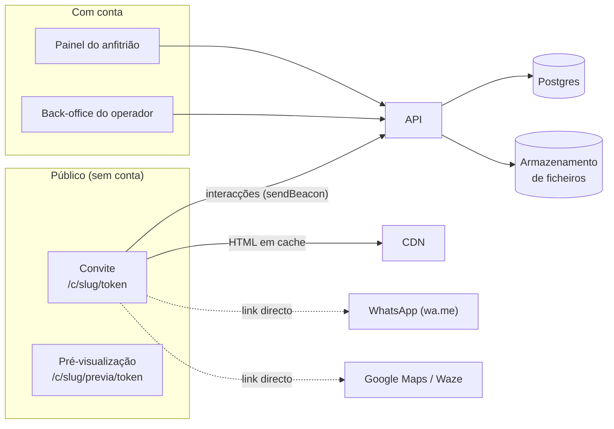
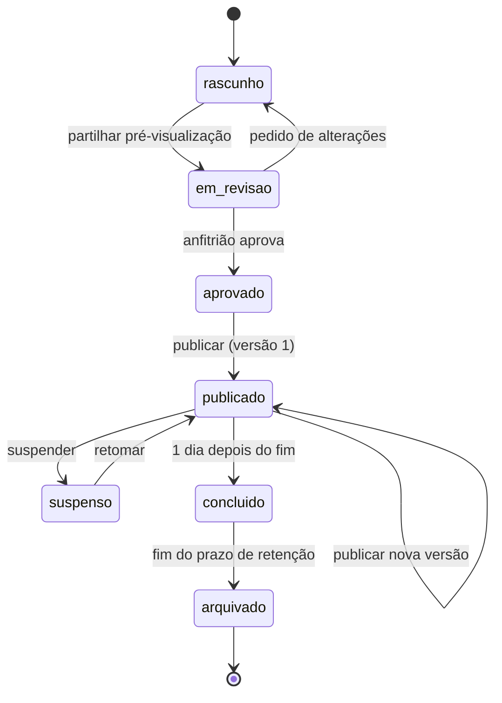
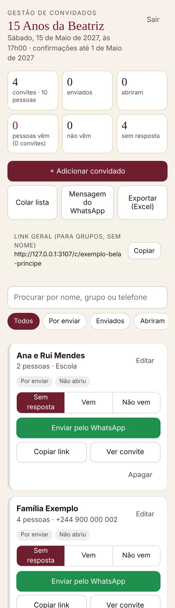
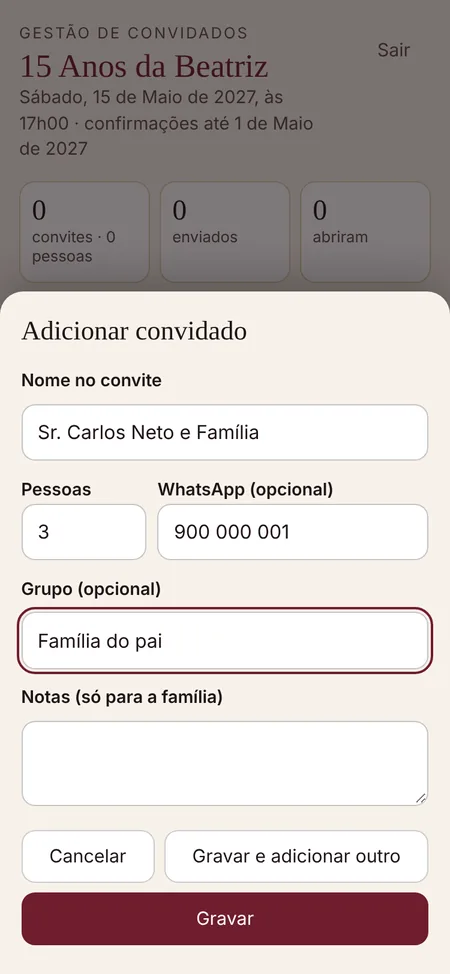

# 05 · Plataforma

O que se constrói à volta do convite: criar, rever, publicar, enviar e acompanhar. A experiência do convite está no [02](02-experiencia-do-convite.md) e as entidades no [04](04-modelo-de-dados.md).

> Tudo o que está marcado **«a confirmar»** é uma proposta. Antes de implementar, confirmar com o titular do projecto (ver [08](08-roadmap.md#decisões-em-aberto)).

> **Estado (Novembro de 2026):** a primeira parte da plataforma está em [`apps/web`](../apps/web/). Tem o convite servido com links pessoais (token no caminho), a **confirmação dentro do convite** ([decisão 0003](decisoes/0003-confirmacao-dentro-do-convite.md)) e a **zona de gestão de convidados** para a família, com acesso por PIN ([decisão 0001](decisoes/0001-gestao-de-convidados-pela-familia.md)). Fica alojada no **cPanel** do titular ([decisão 0002](decisoes/0002-alojamento-no-cpanel.md)). O resto deste documento continua a ser o alvo.

## Módulos



| Módulo | Para quem | Fase |
|---|---|---|
| **Renderizador do convite** | Convidados (público) | MVP |
| **Back-office do operador** | Equipa celebramos.ao | MVP |
| **Painel do anfitrião**: aprovação, convidados, confirmações | Clientes | MVP |
| **Assistente self-service** e pagamentos | Clientes | Fase 2 |

## Estados de um convite



- **rascunho / em_revisao:** só a pré-visualização funciona (modo demonstração, sem números de WhatsApp reais se o anfitrião preferir).
- **publicado:** os links dos convidados funcionam. Cada publicação cria uma **versão** imutável. Os convidados vêem sempre a última versão publicada.
- **suspenso:** os links mostram «Este convite não está disponível de momento.» (HTTP 410), sem dados do evento.
- **concluido:** o convite continua acessível (contagem a zeros, «chegou o grande dia!»). O painel deixa de sugerir envios.
- **arquivado:** os dados pessoais dos convidados e as interacções são apagados (ver [06](06-requisitos-nao-funcionais.md#privacidade-e-protecção-de-dados)). Os links respondem 410.

## Papéis e permissões

| Acção | Proprietário | Editor | Revisor | Operador | Admin |
|---|:-:|:-:|:-:|:-:|:-:|
| Ver a pré-visualização | ✔ | ✔ | ✔ | ✔ | ✔ |
| Aprovar ou pedir alterações | ✔ | ✔ | ✔ | ✔ | ✔ |
| Editar o conteúdo e o tema | ✔ | ✔ | — | ✔ | ✔ |
| Gerir convidados e enviar links | ✔ | ✔ | — | ✔ | ✔ |
| Ver aberturas e confirmações | ✔ | ✔ | — | ✔ | ✔ |
| Publicar, suspender | ✔ | — | — | ✔ | ✔ |
| Exportar a lista de convidados | ✔ | — | — | ✔ (fica registado) | ✔ |
| Apagar o evento e os dados | ✔ | — | — | — | ✔ |
| Gerir temas | — | — | — | ✔ | ✔ |

- **Proprietário:** quem contrata (ex.: pai ou mãe da debutante). Pode convidar editores e revisores.
- **Revisor:** familiar que só aprova. Na fase 1 basta o link de pré-visualização, sem conta.
- **Operador:** acede aos eventos dos clientes que atende. As acções sobre dados pessoais ficam num registo de auditoria.

## Autenticação

*A confirmar (fornecedor e custos).*

- **Anfitriões:** entrada com o número de telemóvel e um código de uso único enviado por SMS ou WhatsApp. Alternativa: email com link mágico. Sem palavras-passe. Sessão de 30 dias em cookie `HttpOnly`, `Secure`, `SameSite=Lax`.
- **Operadores e administradores:** email e segundo factor (TOTP) obrigatório.
- **Revisores na fase 1:** sem conta. O link de pré-visualização (`token_previa`) é o acesso, e pode ser renovado para cortar o acesso.
- **Família, implementado:** a zona de gestão de convidados usa um **PIN por evento** (6 algarismos) em vez de contas.
  - Hash scrypt e sessão de 30 dias em cookie assinado (HMAC).
  - Mudar o PIN termina as sessões.
  - Ao fim de 10 tentativas erradas, o acesso bloqueia durante 15 minutos.
  - É uma solução transitória: as contas com código por telemóvel (E5-S5) substituem-na.

## Back-office do operador (MVP)

Objectivo: montar e alterar um convite sem tocar em código. Meta: ≤ 2 horas para um convite novo com tema existente.

1. **Criar evento:** tipo, homenageado, data e hora, menor (sim/não). O slug é gerado automaticamente.
2. **Editor por secções:** um formulário por secção, gerado a partir do esquema, com:
   - textos com contagem de caracteres e limites do esquema;
   - listas ordenáveis (eventos, cronograma, manual, presentes) com selector de ícones;
   - local por pesquisa ou colando um link do Google Maps (extrair as coordenadas de `?q=lat,lng` e de `@lat,lng`);
   - números de WhatsApp validados (Angola: `+244 9XX XXX XXX`).
3. **Ordem das secções:** arrastar e largar, e ligar ou desligar secções.
4. **Tema:** escolher entre os temas publicados, ou criar um tema a partir de um existente (tokens com verificação de contraste).
5. **Decoração:** calculada automaticamente pelas regras do [02 §7](02-experiencia-do-convite.md#7-harmonia-entre-secções). O operador pode fazer ajustes por secção.
6. **Pré-visualização ao vivo:** o convite real num `iframe` com moldura de telemóvel (larguras 320, 375 e 430). Recebe a configuração por `postMessage` a cada alteração, sem gravar. Botão para saltar para uma secção.
7. **Validação antes de publicar:** esquema, regras de coerência (`validar_config.py`), contraste do tema, eventos sem local assinalados e prazo de confirmação antes da data.
8. **Partilhar pré-visualização** e **publicar** (com nota de versão).

## Pré-visualização e aprovação

- Link `/c/{slug}/previa/{token_previa}`: modo demonstração, com um convidado de exemplo ou o primeiro convidado da lista. Faixa discreta «Pré-visualização» e `noindex`.
- O anfitrião pode **aprovar** ou **pedir alterações** num botão fixo da pré-visualização.
- **Fase 2:** comentários presos a uma secção (o revisor toca numa secção e escreve). Hoje isto acontece no WhatsApp, com capturas de ecrã assinaladas.

## Zona de gestão de convidados

**Implementada** em `apps/web` (`/gestao/{slug}`). É o sítio onde a família cadastra e acompanha os convidados, no telemóvel ou no computador.

 

| Função | Comportamento |
|---|---|
| Entrar | PIN do evento. O ecrã de entrada só mostra o nome do evento. |
| Resumo | Convites e pessoas convidadas, enviados, abriram, pessoas que vêm, não vêm, sem resposta. Depois do prazo de confirmação, o cabeçalho diz «prazo terminado». |
| Adicionar convidado | Nome como aparece no envelope, pessoas (1–30), WhatsApp (opcional, normalizado para `244…`), grupo, notas. Avisa se o nome já existir. Tem «Gravar e adicionar outro». |
| Colar lista | Um convidado por linha (`nome; pessoas; telefone; grupo`). Mostra a pré-visualização com as linhas inválidas assinaladas antes de importar. |
| Enviar pelo WhatsApp | Abre `wa.me` com a mensagem e o link pessoal e marca «Enviado». A mensagem é editável, com `{convidado}`, `{homenageado}`, `{dataCurta}`, `{hora}`, `{pessoas}` e `{link}` (obrigatório). |
| Copiar link, Ver convite | «Ver convite» abre com `?previa=1`, que não conta como abertura. |
| Resposta | Sem resposta, Vem (com o número de pessoas que vêm) ou Não vem. O convidado responde no convite ([Confirmações](#confirmações)), e a família pode marcar ou corrigir à mão. Se a família alterar a resposta do convidado, o cartão mostra o que ele respondeu. |
| Sinais por convidado | «Enviado», «Abriu» (primeira abertura), «Respondeu no convite» (com a mensagem do convidado, se a deixou) e «Tocou em confirmar» (só depois do prazo, quando o convite volta a ter apenas os botões do WhatsApp), com data e hora de Luanda. |
| Filtros e pesquisa | Por enviar, enviados, abriram, não abriram, vêm, não vêm, sem resposta. Pesquisa sem acentos. |
| Link novo | Gera outro token: o link anterior deixa de funcionar (enviado à pessoa errada). |
| Apagar | Retira o convidado. O link deixa de funcionar. |
| Exportar | CSV para o Excel (separador `;`, BOM UTF-8): nome, pessoas, telefone, grupo, estado, pessoas confirmadas, datas (envio, abertura, toque em «Confirmar», resposta no convite), mensagem do convidado, notas, link. |
| Vários familiares | Gravação com concorrência optimista (ETag). Alterações em simultâneo, da família ou dos convidados, não se perdem. A lista actualiza ao voltar à página e de 30 em 30 segundos. |

Ainda não implementado: importar ficheiros CSV ou Excel, contactos do telemóvel, partilha nativa, lembretes e ligar ou desligar o link geral na interface.

## Convidados

### Lista

- **Adicionar um a um:** nome como aparece no envelope, número de pessoas, telefone (opcional), etiqueta.
- **Colar texto:** um convidado por linha, com separadores tolerantes (`;`, `,`, tabulação, ` - `):
  ```
  Sr. Carlos Neto e Família; 3; 923 000 000
  Ana e Rui Mendes, 2
  Tia Joana
  ```
  Sem número de pessoas, assume 1. Mostrar uma pré-visualização com os erros assinalados antes de importar.
- **Importar CSV ou Excel** (colunas `nome`, `pessoas`, `telefone`, `etiqueta`).
- **Contactos do telemóvel** (opcional): Contact Picker API onde existir (Chrome para Android).
- Detectar duplicados (mesmo nome ou telefone).

### Links e envio

- Cada convidado tem um **link pessoal** `/c/{slug}/{token}`. O **link geral** `/c/{slug}` serve para grupos e estados do WhatsApp (pode ser desligado).
- **Enviar pelo WhatsApp:** abre `https://wa.me/{telefone}?text={mensagem}`. Sem telefone, abre `https://wa.me/?text={mensagem}`, e o anfitrião escolhe o contacto. Marca `enviado_em`. Mensagem editável, por exemplo:
  > Olá, {convidado}! Com muita alegria, convidamos para os 15 anos da {homenageado}, no dia {dataCurta}. Abra o seu convite aqui: {link}
- **Copiar link** e **partilha nativa** (`navigator.share`) como alternativas.
- **Revogar** um link (convidado removido ou link reenviado por engano) e **gerar um novo**.

## Confirmações

**Decisão actual ([0003](decisoes/0003-confirmacao-dentro-do-convite.md), implementada em `apps/web`):** no link pessoal, o convidado responde **dentro do convite**, e o WhatsApp abre no mesmo toque com a mensagem para a família. O WhatsApp continua no caminho porque é o canal preferido das famílias. Quem envia o aviso é sempre o convidado: o envio automático em nome da família exige a WhatsApp Business API ([01](01-produto.md#fora-para-já)).

- **Link pessoal, até ao prazo:**
  - O convidado escolhe vou ou não vou («vamos» ou «não vamos» num convite para várias pessoas), quantas pessoas vão (de 1 até ao número do convite; por omissão, todas) e, se quiser, escreve uma mensagem para a família (até 300 caracteres). O que aparece no ecrã está no [02 §4.3](02-experiencia-do-convite.md#43-confirmação-de-presença).
  - O botão redondo envia. Abre `wa.me` com a mensagem do que está escolhido (a de confirmação, com as pessoas, ou a de recusa, seguida da mensagem do convidado) e, no mesmo toque, grava a resposta com `fetch` (`keepalive`). Se a gravação falhar, o WhatsApp abre na mesma, e o convite pede ao convidado que envie a mensagem.
  - A resposta muda o estado do convidado: **confirmado**, com as pessoas, ou **recusado**. Fica guardada com a data e a mensagem, e aparece logo na zona de gestão.
  - Ao reabrir o link, o convite mostra a resposta registada (também a que a família marcou) e «Alterar resposta».
- **Link pessoal, depois do prazo:** o formulário fecha.
  - O prazo é o fim do dia de `confirmacao.ate` («1 de Maio de 2027») em Luanda. Se o texto não for uma data por extenso, ou for depois da festa, o prazo é o início da festa.
  - O convite mostra a resposta registada, se houver, e os botões do WhatsApp, que registam o toque (`confirmar`) como antes. O servidor responde 410.
- **Link geral e protótipo:** só o WhatsApp, como antes. Os botões apontam **directamente** para `wa.me`, para funcionar mesmo se a plataforma falhar e sem pedidos extra em redes lentas. No link geral, `{convidado}` passa a «[o seu nome]» e a família marca a resposta à mão.
- **Pré-visualização** («Ver convite» na zona de gestão): mostra o formulário, mas não grava.
- **Na zona de gestão**, a família vê «Respondeu no convite», a data e a mensagem. A resposta conta no resumo, nos filtros e na exportação. A família pode corrigi-la, e o cartão mostra o que o convidado respondeu.

### Painel do anfitrião

- **Números:** convidados e pessoas convidadas, links enviados, abertos, responderam no convite, confirmados (pessoas), recusados, pendentes.
- **Lista** filtrável por estado e etiqueta, com a data da primeira abertura e da última resposta no convite.
- **Lembrete:** para os pendentes, abre o WhatsApp com uma mensagem de lembrete e o link pessoal.
- **Exportar** CSV ou Excel (nome, pessoas, estado, pessoas confirmadas, etiqueta).

## Alterações depois de enviar

- Publicar uma nova versão actualiza **todos os links** de imediato. As URLs nunca mudam.
- Se a **data, a hora ou o local** mudarem:
  - o painel sugere avisar os convidados (lista com «Enviar actualização pelo WhatsApp» e uma mensagem pré-escrita);
  - o `.ics` ganha um `SEQUENCE` novo.
- O histórico de versões permite comparar e **repor** uma versão anterior (republicando-a como versão nova).

## Rotas públicas

| Rota | Resposta |
|---|---|
| `GET /c/{slug}` | Convite geral. 404 se `link_geral_activo` for falso. |
| `GET /c/{slug}/{token}` | Convite pessoal. Token desconhecido ou revogado: 404 (mesma página que um slug inexistente, para não revelar nada). |
| `GET /c/{slug}/previa/{token_previa}` | Pré-visualização (modo demonstração). |
| `GET /c/{slug}/calendario.ics` | Ficheiro de calendário ([04 §6](04-modelo-de-dados.md#6-ficheiro-de-calendário-ics)). |
| `GET /c/{slug}/img/{ficheiro}` · `GET /c/{slug}/{token}/img/{ficheiro}` | Foto da galeria do evento ([04 §8](04-modelo-de-dados.md#8-implementação-actual-appsweb)), com a regra de acesso do convite: pelo link geral só enquanto estiver activo, pelo pessoal só com token válido (não conta como abertura). Qualquer falha, incluindo nomes com pastas ou sem extensão de imagem, dá o mesmo 404 do convite. `Cache-Control: private` (nenhuma cache partilhada a guarda) e `ETag`. *(implementado)* |
| `GET /temas/{tema}/og.jpg` | Imagem de partilha do tema, 1200 × 630 ([06](06-requisitos-nao-funcionais.md#seo-e-partilha)). *(implementado; uma imagem por evento, em `/c/{slug}/og.jpg`, fica para depois)* |
| `POST /c/{slug}/{token}/i` | Interacções (`sendBeacon`, corpo `{"tipo": "aberto" \| "confirmar"}`). Uma vez por aparelho. Responde 204 mesmo com erro. *(implementado)* |
| `POST /c/{slug}/{token}/resposta` | Resposta do convidado dentro do convite: `{"estado": "confirmado" \| "recusado", "pessoas"?, "mensagem"?}`. Tem o acesso do convite: um slug ou token desconhecido dá o mesmo 404. Responde 204 quando grava, 400 com dados inválidos, 410 depois do prazo e 429 com mais de 10 respostas numa hora no mesmo link. *(implementado)* |
| `GET /gestao/{slug}` | Zona de gestão de convidados (PIN). *(implementado)* |

Todas as respostas de `/c/` levam `X-Robots-Tag: noindex, nofollow`, e as páginas também `<meta name="robots" content="noindex, nofollow">`.

## API interna (indicativa)

**Implementado** (zona de gestão, todos com sessão e, nas alterações, o cabeçalho `X-Celebramos: 1`):

| Método e rota | Função |
|---|---|
| `POST /api/gestao/{slug}/entrar` · `/sair` | Entrar com `{pin}` (cookie de sessão) e sair |
| `GET /api/gestao/{slug}/dados` | Evento, mensagem de envio e convidados com o link e a actividade |
| `POST /api/gestao/{slug}/convidados` | Cadastrar |
| `POST /api/gestao/{slug}/convidados/importar` | `{texto}` dá a pré-visualização. `{texto, confirmar: true}` grava |
| `PATCH/DELETE /api/gestao/{slug}/convidados/{token}` | Alterar (dados, `estado`, `pessoasConfirmadas`, `enviado`, `novoLink`) ou apagar |
| `PUT /api/gestao/{slug}/mensagem` | Mensagem do WhatsApp |
| `GET /api/gestao/{slug}/exportar` | CSV |

Sugestão para o resto (painel completo e back-office). Se a stack o favorecer, usar *server actions* ou RPC tipado.

| Método e rota | Função |
|---|---|
| `POST /api/eventos` · `GET/PATCH /api/eventos/{id}` | Criar, ler, editar (o conteúdo é validado contra o esquema) |
| `POST /api/eventos/{id}/previa` | Gerar ou renovar o link de pré-visualização |
| `POST /api/eventos/{id}/publicar` · `/suspender` · `/retomar` | Publicação (cria a versão e invalida a cache) |
| `GET /api/eventos/{id}/versoes` · `POST …/versoes/{n}/repor` | Histórico |
| `GET/POST /api/eventos/{id}/convidados` · `POST …/convidados/importar` | Lista e importação (com pré-visualização) |
| `PATCH/DELETE /api/convidados/{id}` · `POST …/{id}/revogar` | Estado, pessoas, revogação |
| `GET /api/eventos/{id}/estatisticas` · `GET …/exportar?formato=csv|xlsx` | Painel e exportação |
| `GET/POST /api/temas` · `POST /api/ficheiros` | Temas e envio de ficheiros (URL assinada) |

## Arquitectura proposta

*A confirmar.* Escolhida para uma equipa pequena com agentes de código: uma linguagem (TypeScript), um repositório e serviços geridos.

```
apps/web             Next.js (App Router): painel, back-office, rotas públicas /c/…
packages/convite     renderizador: configuração → HTML (TypeScript puro, sem framework)
packages/esquemas    convite.schema.json + tipos TypeScript gerados + validação
packages/temas       kits de temas (tokens e imagens)
prototipo/           referência (este repositório); a arte procedural continua em Python
```

| Peça | Proposta | Notas |
|---|---|---|
| Linguagem | TypeScript | |
| Web | Next.js | Painel e back-office em React. O **convite não usa React no cliente** (ver abaixo). |
| Base de dados | Postgres gerido + ORM com migrações (Drizzle ou Prisma) | `conteudo` e `configuracao` em `jsonb` |
| Ficheiros | Armazenamento compatível com S3 + CDN (proposta). Hoje são ficheiros no servidor | Variantes AVIF/WebP geradas no envio (sharp) |
| Alojamento | **Decidido: cPanel do titular** ([0002](decisoes/0002-alojamento-no-cpanel.md)). A proposta original era Vercel ou equivalente | Verificar onde fica o servidor e as regras de transferência internacional ([06](06-requisitos-nao-funcionais.md#privacidade-e-protecção-de-dados)) |
| Testes | Playwright (aceitação, porta de `verificar.py`), Vitest, axe-core, Lighthouse CI | Ver [07](07-criterios-de-aceitacao.md) |
| CI | GitHub Actions | O protótipo já tem um fluxo (`.github/workflows/prototipo.yml`) |
| Erros | Serviço de monitorização de erros (ex.: Sentry) | Sem dados pessoais nos eventos |

### Implementação actual

| Peça | Em uso |
|---|---|
| Alojamento | cPanel do titular (Host2Africa), **Setup Node.js App** (Passenger, Node.js 24), domínio `celebramos.ao` ([decisão 0002](decisoes/0002-alojamento-no-cpanel.md)). |
| Aplicação | Next.js 16 em `apps/web` (ainda sem `packages/`), em modo `standalone`. O ficheiro de arranque é `server.js` e o renderizador está em `src/convite/`. |
| Template do convite | O do protótipo, copiado na construção (`scripts/sincronizar-prototipo.mjs`). |
| Dados | Ficheiros JSON em `CELEBRAMOS_DADOS`, fora da aplicação, com escrita condicional por ETag e bloqueio entre processos. |
| Eventos | `CELEBRAMOS_DADOS/eventos/{slug}/evento.json`, ou a variável `CELEBRAMOS_EVENTOS`. As fotos da galeria ficam em `eventos/{slug}/img/`. São preparados com `scripts/preparar-evento.mjs`. |
| Construção e publicação | O CI constrói e testa o pacote (artefacto `celebramos-web`), que se envia para o cPanel. Nada é construído no servidor. |
| Testes | `apps/web/testes/e2e.py` (Playwright), contra o próprio pacote em 2 processos, no CI (`.github/workflows/plataforma.yml`). |

### O renderizador do convite

- É uma **função pura** `renderizarConvite(configuracao, convidado | null, opcoes) → HTML`, testável sem servidor.
- **HTML completo gerado no servidor**: todos os textos, o nome do convidado e os links de WhatsApp já vêm no HTML, e o JavaScript só trata das interacções (envelope, galeria, contagem, música, interacções). Melhora o primeiro ecrã, a acessibilidade e a robustez.
- **JavaScript próprio, sem framework**, ≤ 15 KB comprimido. É a abordagem do protótipo, pensada para telemóveis modestos.
- **CSS crítico embutido.** Fontes e imagens com nomes com *hash* e `Cache-Control: public, max-age=31536000, immutable`.
- **Sem JavaScript**, o convite continua legível: o ecrã de abertura é escondido por `<noscript><style>` e o conteúdo não começa `inert`, porque é o script que o bloqueia.
- **Cache:** HTML em cache na CDN por URL, invalidado por etiqueta (`evento:{id}`) ao publicar, suspender ou revogar. O caminho mais rápido para a paridade é começar por portar o `template.html` com a configuração injectada no servidor e passar os textos para o servidor depois.

### Imagem de partilha (Open Graph)

Hoje há **uma por tema** (`temas/<tema>/og.jpg`, gerada por `prototipo/arte/gerar_og.py`), sem texto: o nome do evento vai no `og:title`. Alvo: gerada ao publicar (1200 × 630, JPEG, ≤ 300 KB), com fundo e arte do tema, nome do homenageado, tipo de evento e data. **Sem fotografias** em eventos de menores e **sem o nome do convidado**.

### Tarefas em segundo plano

Variantes de imagens, imagem de partilha, retenção de dados (apagar ou arquivar), resumo diário para o anfitrião (fase 2).

## Do protótipo à plataforma

O protótipo aceitou compromissos por causa do alojamento estático. A plataforma **tem de** corrigi-los. Estado em `apps/web`:

| # | No protótipo | Na plataforma | Estado |
|---|---|---|---|
| 1 | Link pessoal por `#código`, com a **lista completa de convidados no HTML** | Token no caminho (`/c/{slug}/{token}`). Só o convidado actual é enviado ao navegador (`convidadoActual`). | Feito |
| 2 | Textos preenchidos por JavaScript (`data-t`) | HTML final gerado no servidor. | Por fazer |
| 3 | Campos redundantes na configuração (`data.dia`, `calendario.inicioUTC`…) | Derivados de `evento.inicio` e do fuso ([04 §4](04-modelo-de-dados.md#4-campos-derivados)). | Por fazer (o validador garante a coerência) |
| 4 | Textos fixos de 15 anos (`h1` «Convite para os 15 anos de…», «Mensagem da debutante», campo `debutante`) | Textos por tipo de evento. Campo `homenageado`. | Por fazer |
| 5 | Marcadores da mensagem substituídos só na primeira ocorrência (`.replace`) | Substituir todas as ocorrências. | Feito (zona de gestão e convite) |
| 6 | Google Fonts | Fontes alojadas na plataforma, com pré-carregamento. | Por fazer |
| 7 | Sem metadados Open Graph | `og:title`, `og:description`, `og:image` por evento. | Feito (imagem por tema: `temas/<tema>/og.jpg`) |
| 8 | Sem JavaScript, o ecrã de abertura bloqueia a página | `<noscript>` e bloqueio só por script. | Parcial: o envelope já não bloqueia, mas os textos dependem de JS (linha 2) |
| 9 | Ícones num JSON embutido | Só os ícones usados, embutidos no servidor. | Por fazer |
| 10 | Decoração escrita à mão por secção | Calculada a partir da ordem (regras do [02 §7](02-experiencia-do-convite.md#7-harmonia-entre-secções)). | Por fazer |
| 11 | Calendário sem `.ics` no alojamento de demonstração (downloads bloqueados) | `.ics` servido pela plataforma. | Feito (`/c/{slug}/calendario.ics`) |
